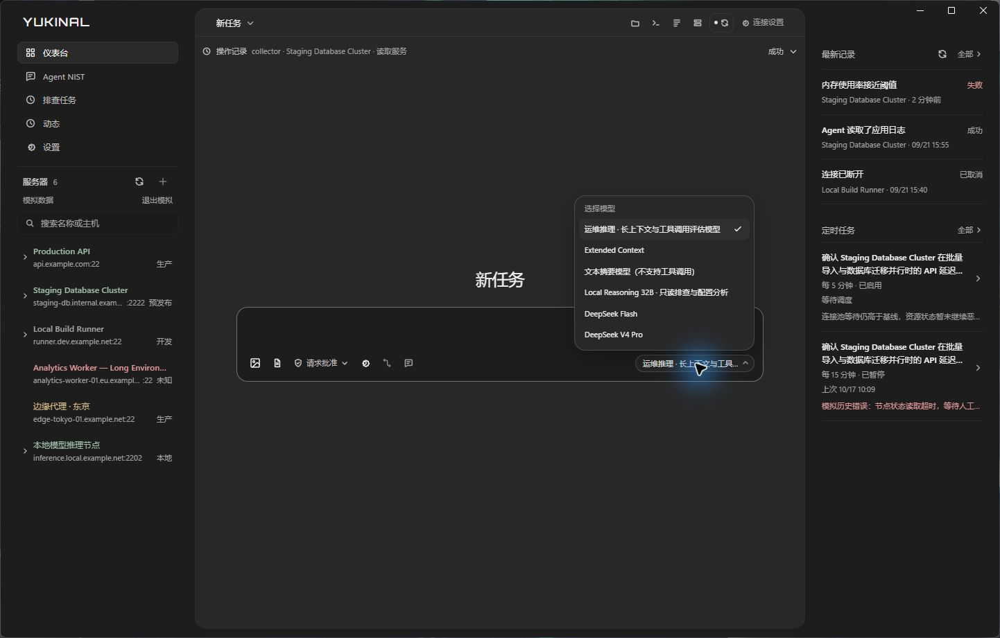
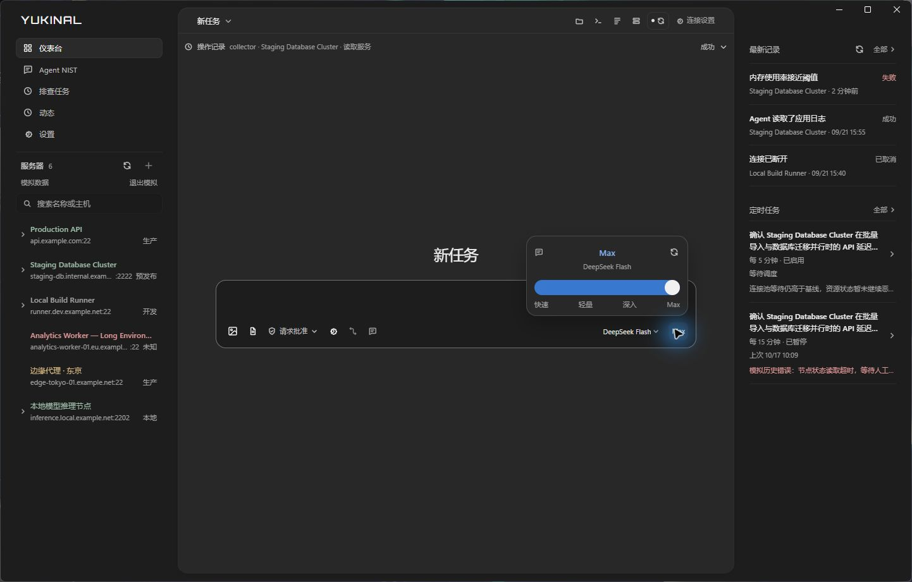
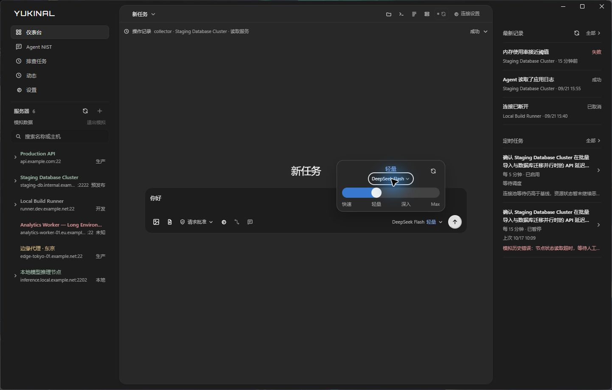
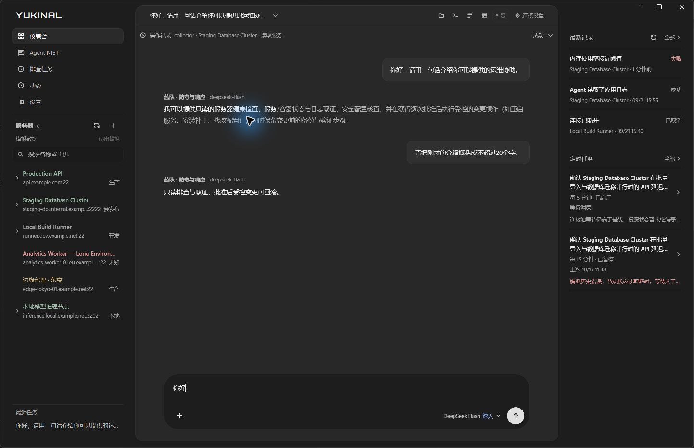
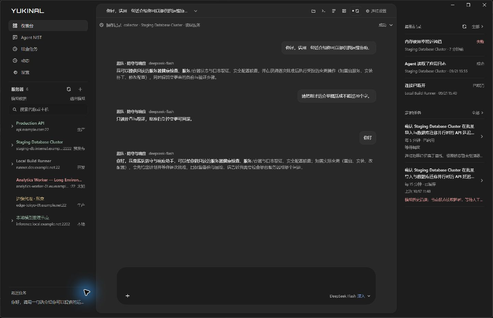

# AI 面板验证记录 · 2026-10-17

本轮按用户提供的三张参考图调整批准菜单、模型列表和推理强度控件。批准菜单保留现有 ask / auto 契约，“完全访问权限”暂不可选，没有扩大宿主权限。模型列表显示已启用连接中的实际配置，重复名称才补充连接来源。

推理档位依据 [DeepSeek 官方 thinking mode 文档](https://api-docs.deepseek.com/guides/thinking_mode)，仅用于官方 HTTPS Chat 接口的 `deepseek-flash` 与 `deepseek-v4-pro`。默认不覆盖模型参数；四档在共享契约、桌面请求与 Python 适配器中贯通，执行工具绑定及输出预算绑定后参数仍保留。未支持的模型拒绝显式强度参数。

## 实际窗口

在用户已打开的工作树原生主窗口（1442 × 921）检查批准菜单、模型列表、DeepSeek 强度入口和键盘切换。浏览器实际页面另行检查 680 × 760 与 440 × 680 内容视口；440px 视口页面宽度为 440px，强度弹层右边界为 402px，没有撑宽页面。菜单可由 Escape 关闭并恢复入口焦点。

以下截图使用开发模拟目录，无密钥、不发送请求。它们验证布局，不能替代下方真实模型请求记录。

## 真实对话

使用用户授权的临时 Key，经过当前源码的 Python sidecar、角色系统提示、会话上下文与模型适配器，向 DeepSeek 官方接口发送四轮同步请求。测试用临时会话存储，结束后移除；Key 仅注入测试进程环境，未写入源码、截图或提交。

| 档位 | 对话验证 | 可见回复摘录 | 结果 |
| --- | --- | --- | --- |
| 快速 / none | 记住测试代号 | 已记住 PANEL-7319。 | completed |
| 轻量 / low | 复述上一轮代号 | 刚才的服务器代号是 PANEL-7319。 | completed |
| 深入 / high | 给出三项只读建议 | 系统负载、服务与日志、网络与端口的 Markdown 列表 | completed |
| Max / max | 概括建议并保留代号 | 针对代号 PANEL-7319 的服务器，三项只读排查建议可概括为…… | completed |

四轮工具调用数均为 0，上下文依次包含 0、1、2、3 轮历史。没有连接 SSH 或修改服务器。记录只保留最终可见回答，不保存模型内部推理。该结果验证运行时请求链；原生界面的真实发送、流式展示与凭据配置流程尚未在这次主窗口检查中贯通。

## 自动检查

- `pnpm check` 通过：桌面 312 项、共享契约 133 项、两个 SDK 共 9 项、命令运行器 7 项；类型检查、生产构建、CTest 6/6 和源码侧车 smoke 通过。
- Python 全量 146 项测试通过，其中 4 项因环境条件跳过；新增参数、绑定、校验与请求指纹测试通过。
- 模拟目录增加不含凭据的 DeepSeek 两模型样例，用于检查强度控件；继续禁止向真实 Agent 发送模拟目标。

## 追加反馈：合并模型入口与回车输入

模型与强度现在共用一个入口，弹层内的模型名称可以点击选择；删除弹层左侧快捷图标。无强度能力的模型仍能在相同位置切换模型。普通 Enter 换行，Ctrl+Enter / Command+Enter 发送，候选列表仍支持 Enter 与 Tab 补全；输入法组合确认不会误选候选或提交。输入框常态边线降为 3%，聚焦为 6%，保持无发光。

本次新增输入键盘回归测试，连同模型、能力判断、会话与运行锁定测试共 18 项通过；完整桌面测试 315/315、类型检查与生产构建通过。实际浏览器验证未就绪状态下两行中文输入、快捷发送后草稿保留；440 × 680 视口页面宽度仍为 440px，嵌套模型菜单可访问。原生 1442 × 921 窗口已显示新控件，并打开弹层中的实际模型列表。本次没有新增真实模型请求；前述四轮对话仍是上一轮运行时证据。

## 追加反馈：同心圆角、附件入口和真实桌面对话

输入框圆角增至 29px；发送按钮为 36px 正圆，右侧与底部各留 10px 内边距，边线计入圆角计算。浏览器实测右/下间距均约 10.67px（边线经 WebView 像素取整），模型入口保留在发送按钮左侧。左侧工具栏只剩一个“＋”，附件、权限与运行设置收进同一菜单。图片缩略图与文件条共用可换行附件区，错误提示在没有成功添加附件时也能显示。

发送不可用的根因是原生启动器固定进入 `?fixture=1`，前端又把整个模拟模式视为禁止发送。现在只在存在原生宿主时开放明确列举的模型、运行及对话命令；浏览器模拟仍不发送请求。模拟服务器与任务不传入真实运行，预览对话在独立预览用户目录保存为全局会话，并强制 `toolAccess: "none"`；Python 工具执行边界拒绝所有工具，限制也绑定到请求指纹和恢复检查点。真实模式原有服务器会话范围与权限保持原样。

使用用户已授权的临时 DeepSeek Key，在当前原生预览目录接入 DeepSeek Flash，凭据保存在 Windows 凭据库，源码、日志、截图与提交均无 Key。直接在原生窗口发送两轮：第一轮点击发送按钮介绍运维协助，第二轮 Ctrl+Enter 要求概括上一轮，均显示真实回答；第二轮回复为“只读排查与取证，批准后受控变更可回滚。”。此记录补齐前述原生发送未贯通的限制。实际请求没有执行工具或连接模拟服务器。

浏览器选择图片和文本文件后显示两类预览；440 × 680 内容视口实测页面宽度 440px，无横向溢出，发送按钮保持正圆且右/下间距相等。原生窗口约 1443 × 931，已显示收拢后的工具栏、模型与真实回复。

自动检查：桌面 318/318、共享契约 133/133、SDK 9/9、CTest 6/6、类型检查和生产构建通过；Python 147 项通过（4 项按环境条件跳过）。统一检查的最后一步最初命中了 Windows 的 Python 商店别名，指定已有虚拟环境后单独重跑 sidecar smoke 通过，其余检查无需重复。原生窗口刷新后从任务列表恢复同一会话，四条消息与角色/模型标记均保留。

## 追加反馈：更紧凑的对话文字

对话正文与输入文字统一为 12px，正文行高 1.6、输入行高 1.5；消息间距从 24px 收至 18px，用户消息内边距与段落间距同步缩小。仅调整 AI 对话区域，保留模型入口与发送按钮尺寸。浏览器实测输入字号 12px、行高 18px，消息间距 18px；当前 987px 视口无页面横向溢出。原生窗口已显示三轮现有对话的新排版，生产构建与差异空白检查通过；本次未发送新的模型请求。

