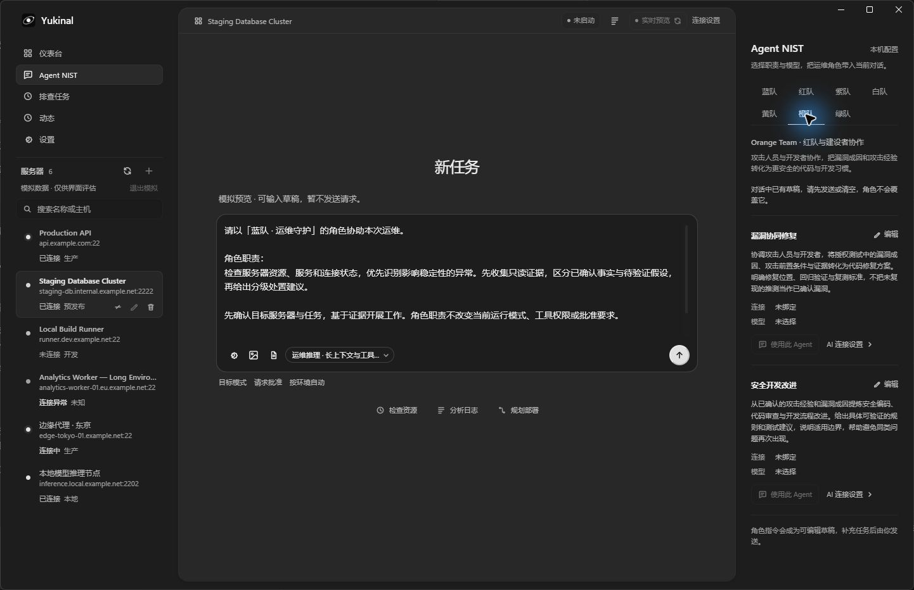
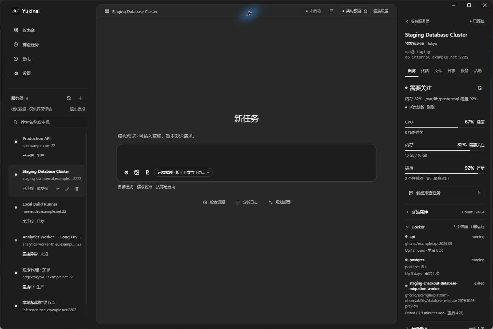
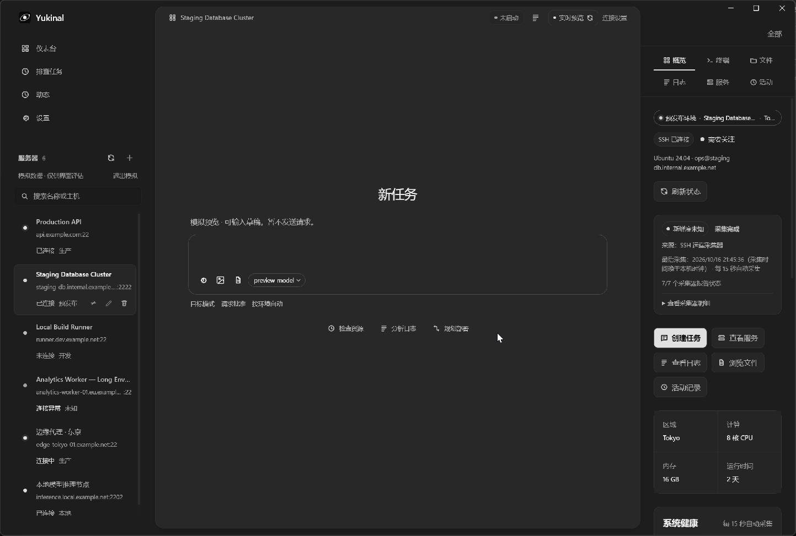
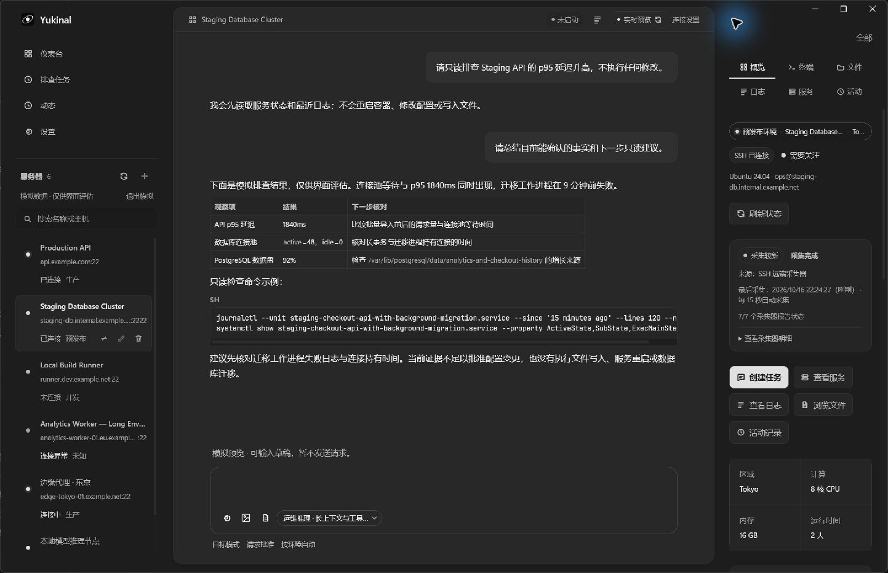
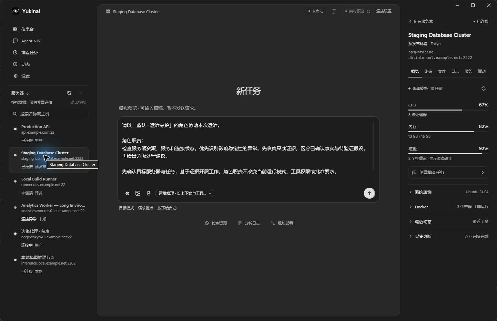

# Windows 桌面窗口方向

Yukinal 使用固定三栏工作区：左侧导航与服务器，中间 AI 对话，右侧参考信息。浏览器开发页用于预览内容，原生窗口行为需要在 Windows 宿主验证。共享视觉规则见 [界面表达与皮肤约定](./ui-design-system.md)。

最新 Windows 开发窗口：左侧导航与服务器列表收紧，仪表台下增加 Agent NIST 角色台。服务器与模型均为模拟样例：

对象检查器方向：输入区按用户色样统一为 `#1d1d1d`，右栏将目标身份、健康与资源读数前置，详情采用可展开分组：

前一版三栏视觉方向记录：

带长对话、资源与异常状态的适配截图：

## 窗口与标题栏

Windows 顶层窗口、外圆角、缩放边缘及最小化／最大化／关闭按钮由 Win32 与 DWM 管理。标题栏高 40 DIP，默认窗口 1440 × 900，最小窗口 1100 × 680；最大化遵循系统边界。

在支持 WebView2 原生区域的宽窗口中，Logo、应用名和中间工具行进入标题栏。空白区域使用原生拖动、系统菜单和双击最大化；交互按钮显式禁止拖动。系统按钮与顶部缩放边缘不进入 WebView 命中区域。不支持的运行时、紧凑窗口和同步失败时保留完整独立标题栏。

## 一套导航与状态

导航依次为仪表台、Agent NIST、排查任务、动态、设置；设置紧接动态。项目入口与页面路由移除。导航和服务器列表统一由 React 使用现有查询、弹窗与服务实现。导航项收紧为 32px，常规服务器行由 92px 收紧为 74px，保留名称、主机、状态和操作。取消另一套原生侧栏及动作桥，避免两套布局、选择和交互维护成本。

Agent NIST 为本机运维角色台，提供蓝、红、紫、白、黄、橙、绿七队共十四个可编辑角色，绑定设置中已有的模型连接。红队职责为授权攻击测试，橙队职责为攻击人员与开发者协作，紫队体现红蓝检测与复测，白队明确范围与停止条件，黄队负责设计开发，绿队负责监控、响应与取证设计。旧配置升级时保留用户修改的字段与模型绑定，不在读取时覆盖原存储。使用角色会在中央对话准备职责草稿，仍由用户补充任务并确认发送；已有草稿／附件和运行中的任务不会被覆盖。角色配置在本机保存，模拟与实际配置隔离。未启用连接可以预先分配，使用前须到设置切换启用。目前不增加多 Agent 并行运行或自动协作调度。

资源概览去掉“健康／需要关注／严重”及重复的阈值总结，保留百分比、容量、采集时间、过期和缺失提示。Docker 默认收起，摘要仍显示容器数与非运行数，避免长镜像名称将整个属性栏撑开。

### 团队工作台的后续交互方向（尚未实现）

一个任务对应一条持续保存的团队对话。默认自动匹配一名主导角色，需要时邀请协作或复核；用户可用 @ 指定参与者。回复保留实际角色与模型署名，切换下一轮角色不改写已有回复，也不默认让七个模型同时发言。白队的职责约束不授予工具权限。

中央区域承载消息与工作页。Markdown、代码、表格先沿用现有消息能力；图表、流程、动画与交互 HTML 通过独立产物打开，交互内容需要隔离运行。文件、终端、日志和服务详情复用现有数据与会话能力，吸附于中央左上或右上，可展开、收起，再打开时回到原工作页。窄窗口只展开一个工作页并安排在正文上方，避免盖住输入框。

工具操作以结构化事件展示角色、服务器、路径或命令、审批状态、结果与时间；对话留摘要，工作页显示当前动作，点击记录回到对应证据。界面收起不等于停止运行，停止命令、关闭视图和断开连接分别处理。桌面置顶需要原生独立窗口与生命周期支持，不能用应用内层级冒充。

历史已有本机保存能力，后续优化入口为左侧少量最近任务与顶部任务名下拉搜索，减少独立“记录管理”模式。完整消息、操作和产物关系按任务保存；上下文整理只改变发给模型的工作上下文。建议默认在可用上下文约 70% 时整理到约 40%，另预留回复和工具预算；这是产品起始值，应按模型实际能力校准。保留目标、约束、角色、证据引用、决策和未完成事项，在完整工具调用／结果与批准边界上整理；未知窗口大小时不能伪造占用百分比。

下一阶段先打通单会话的历史上下文与各角色模型路由，再做工作页宿主与操作记录，随后接入自动匹配、协作调度与上下文整理，最后增加原生弹窗和桌面置顶。右侧先保持一屏摘要，长日志、文件和对话只在各自内容区滚动，避免多层滚动与截断证据。

交互参考为 OpenAI 官方的 [集成终端](https://learn.chatgpt.com/docs/integrated-terminal)、[文件工作页](https://learn.chatgpt.com/docs/artifacts-viewer)、[可视化](https://learn.chatgpt.com/docs/visualizations) 与 [上下文整理机制](https://developers.openai.com/api/docs/guides/compaction)。采用简洁工具入口、模型与推理选择、正文旁工作页等模式，尺寸与整理阈值按 Yukinal 的三栏窗口设计，不作为官方测量值。

`WindowFrame` 只观察现有 workspace store 与服务器查询缓存，不增加轮询或 Agent 状态机。`windowShell.updateContext` 同步当前区域、选中服务器、连接状态和忙碌状态，用于系统窗口标题；可见标题栏不重复面板名称。共享 schema 与 C++ 分别校验枚举、UTF-16 长度和 Unicode。该通道不接受密钥、命令、提示词或审批授权。

`windowShell.updateSurface` 只同步中间面板的有界几何与不透明颜色，供原生标题栏衔接。ResizeObserver 更新位置；隐藏或紧凑布局清除表面。`titlebarOverlay` 表达运行时是否支持原生区域。旧宿主和浏览器保留完整页面。

## 视觉基线

两侧共用宽度 `clamp(280px, 100px + 11vw, 360px)` 和 24px 内容边距。AI 面板填满中间列，使用 16px 内圆角和 12px 窗口内留白。左侧品牌与中间工具行对齐，导航及服务器区域随品牌上移。

中间正文与输入共用最大 760px 阅读列。输入面板与文本框按用户最新色样统一使用 `#1d1d1d`，AI 主面板保留 `#282828`；聚焦、默认及拖入附件时均不发光、无渐变与阴影，以细边线表达状态。消息出现后，正文滚动，输入固定在底部。权限信息常驻框下并允许换行。

右侧服务器详情使用对象检查器：目标身份常驻，六个视图单排排列；健康、新鲜度和三条资源读数位于首屏，完整系统属性、容器、活动与采集诊断按需展开。断线、缓存和采集失败保留明显提示。

设置使用平铺表单分组与分隔线，取消圆角卡片及外观调整入口。开发模式提供 6 台明确标记的模拟服务器，覆盖四种连接状态、中英文长名称及资源数据；模拟请求不进入真实业务接口，AI 只可编辑草稿。

## 验收边界

已执行的原生窗口检查包括拖动、双击最大化／还原、系统最大化／还原按钮和窗口缩放。自动测试覆盖展示契约、无效 Unicode、未知字段、几何上限、旧宿主回退及系统按钮坐标转换。编译和浏览器截图不能替代原生窗口行为验收。

内容适配补充检查使用隔离数据目录的 Windows 原生窗口加载模拟服务器和历史对话，并在浏览器检查 280px 参考栏中的五个设置分区、任务证据、概览、文件冲突、日志、服务和活动。1280 × 720 与 1100 × 680 的浏览器预览用于检查紧凑布局、模型菜单和完整认证表单；该检查证明内容重排，不代表新增的原生缩放验收。完整项目检查、桌面构建与模拟响应契约测试通过。

对象检查器补充验证覆盖 280px 栏的单排六页签、长名称与镜像换行、首屏资源与任务入口，以及默认／聚焦时输入框和外壳均为 `rgb(29, 29, 29)` 且无阴影。该次改动通过桌面类型检查、273 项桌面测试和生产构建。

紧凑侧栏与 Agent NIST 补充验证覆盖 1100 × 680 内容预览、长模型名称的角色表单、三队切换、保存后重新打开、现有草稿阻挡，以及从对话记录使用角色后直接显示可编辑草稿。Windows 原生窗口使用隔离的模拟配置完成绑定和职责交接，系统窗口标题同步为 Agent NIST；未发送模型请求。回归测试覆盖归档会话阻挡、恢复后允许交接、未启用连接及草稿／附件／运行保护。完整 `pnpm check` 通过：283 项桌面测试、130 项共享包测试、6 项原生 CTest、生产构建与 sidecar smoke。

2026-10-17 增量验证：286 项桌面测试、桌面类型检查与生产构建通过；新增旧目录字段迁移、独立模型分配和重复加载测试。浏览器在 1100 × 680 内容预览中逐一切换七队，确认名称与职责对应、角色页无横向溢出；窄参考栏保持两行选择。Windows 原生窗口确认七队、橙队职责修正、已有模拟草稿保留，以及资源摘要去掉分级文案、Docker 默认收起后的首屏。

完整 Snap 悬停、最小化生命周期、激活切换与跨不同 DPI 显示器移动仍需专项验收。安装包、其他平台、完整主题同步、尚未完成的 IPC 命令及真实服务器／模型运行不属于本轮 UI 验收。

宿主实现与边界见 [C++ 桌面宿主](./native-desktop-host.md)。
