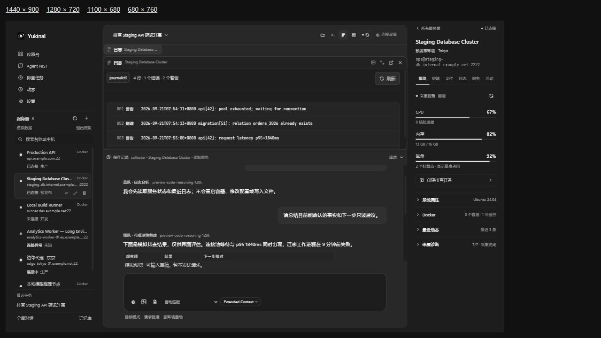
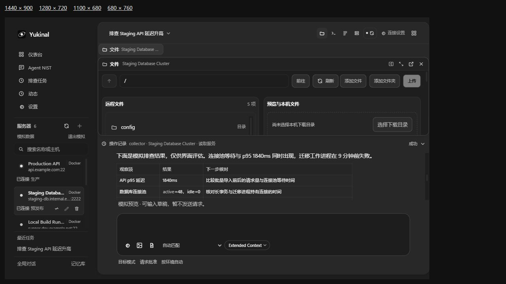
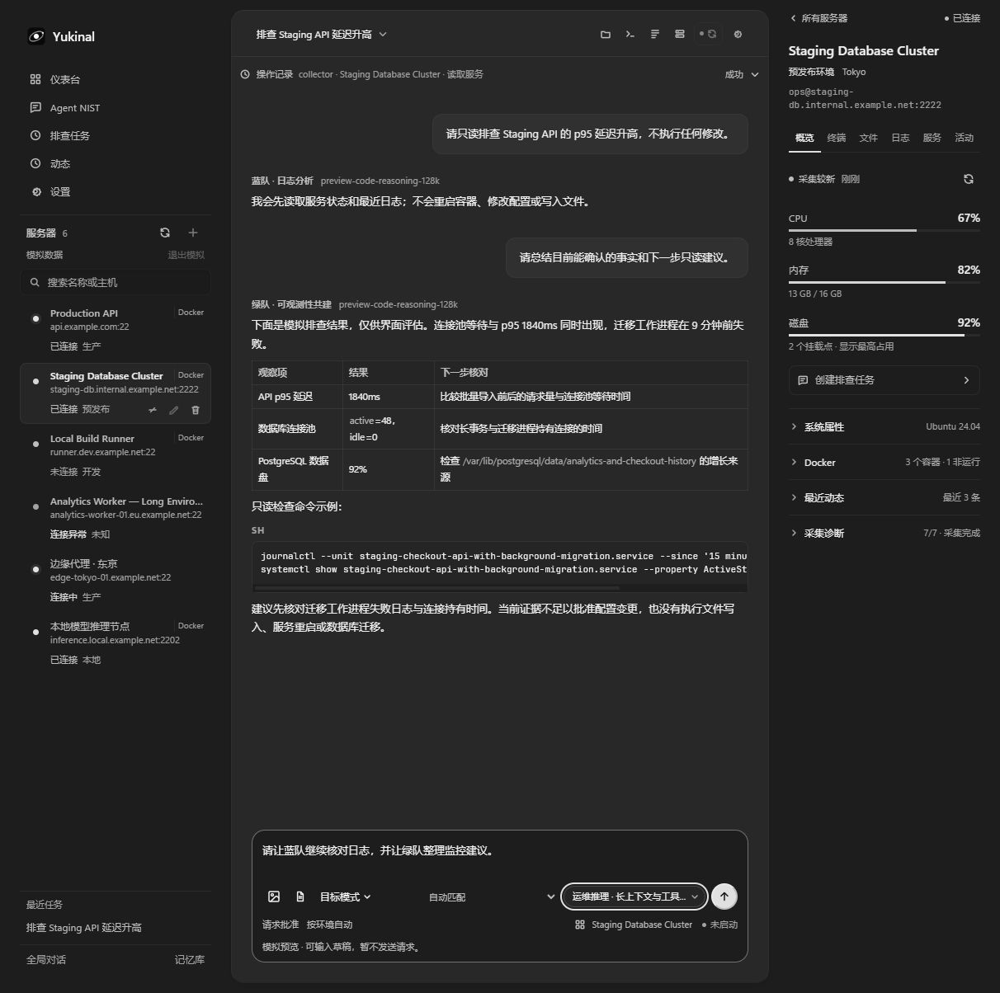
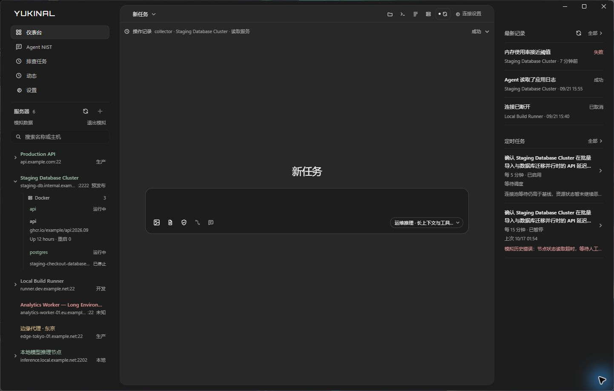

# Windows 桌面窗口方向

Yukinal 使用三栏工作区：左侧导航与服务器，中间团队对话与工作页，右侧参考信息。浏览器开发页用于检查内容重排；原生窗口行为在 Windows 宿主单独验收。共享视觉规则见 [界面表达与皮肤约定](./ui-design-system.md)，数据与上下文边界见 [团队上下文架构](./team-context-architecture.md)。

此前的 Windows 视觉基线使用模拟服务器与模型，不代表本轮共享上下文及独立窗口的运行验收：

## 窗口与标题栏

Windows 顶层窗口、外圆角、缩放边缘及最小化／最大化／关闭按钮由 Win32 与 DWM 管理。主窗口标题栏高 40 DIP，默认窗口 1440 × 900，最小窗口 1100 × 680；最大化遵循系统边界。

在支持 WebView2 原生区域的宽窗口中，应用字标和中间工具行进入标题栏。字标使用随应用分发的 Orbitron 字体，不再显示图片 Logo。空白区域使用原生拖动、系统菜单和双击最大化；交互按钮禁止拖动。系统按钮与顶部缩放边缘由宿主管理。不支持的运行时、紧凑窗口和同步失败时保留独立标题栏。

`WindowFrame` 观察现有 workspace store 与服务器查询缓存，不增加轮询或 Agent 状态机。`windowShell.updateContext` 只同步当前区域、选中服务器、连接状态和忙碌状态，用于系统窗口标题；不接受密钥、命令、提示词或审批授权。`windowShell.updateSurface` 只同步中间面板的有界几何与不透明颜色；隐藏或紧凑布局清除表面。共享 schema 与 C++ 均校验输入，旧宿主和浏览器保留页面布局。

## 导航与团队对话

导航依次为仪表台、Agent NIST、排查任务、动态、设置；设置紧接动态。导航和服务器列表由 React 使用现有查询、弹窗与服务实现。导航项高 32px，服务器父行高 52px，保留名称、主机、环境和独立操作。连接状态通过名称颜色、悬停说明和无障碍名称表达，不增加装饰圆点。

已检测到 Docker 的服务器可展开所属容器；容器继续展开镜像、运行状态和重启次数。读取复用现有快照缓存，只在展开且服务器已连接、主机密钥已信任时请求；断线、空数据和失败均保留实际状态。PVE 未检测时不显示能力。

仪表台改为最新记录与定时任务两组摘要，分别最多展示四条和三条。记录可就地展开，定时任务进入已有管理页；资源读数继续保留在选中服务器的概览。短窗口优先保留入口与关键信息，不铺开整列服务器卡片。

Agent NIST 按蓝、红、紫、白、黄、橙、绿七队组织十四个本机角色，并绑定已有的模型连接。旧配置升级保留用户修改的职责与模型绑定。选择角色将职责作为后续请求的 persona 系统提示，不写入或覆盖用户草稿，也不自动发送；回复保存实际参与者和模型署名。同一对话可逐轮切换角色，复用该对话的历史与工具证据。角色职责不授予工具权限，原有审批边界继续生效。

对话记录、工作上下文和草稿按当前服务器隔离；未选服务器时使用全局范围。全局记忆可供各范围引用，服务器记忆只在对应服务器范围检索。记忆库入口位于 Agent NIST，不占用侧栏底部；提供显式保存、搜索、修改与删除，使用 SQLite FTS5 词项检索，当前没有向量 RAG。全局对话从对话范围控件进入。

模型输入保留预算内的近期完整轮次，并为更早轮次提供有界归档摘录。完整消息、工具调用／结果和审批记录继续保存在本机。整理不删除原始历史，也不使用固定占用百分比冒充模型窗口测量。单会话重置开启新一代工作上下文；重置全部状态还会清空当前草稿和临时视图。两者保留历史、记忆、服务器与连接配置，运行中禁止重置。

参与者 API 支持显式主角色与带父参与者关系的子参与者，校验会话、服务器与上下文代次。当前没有自主调度器，也不默认并行启动七队。

## 中央工作页与独立窗口

文件、终端、日志和服务复用现有业务视图，每页捕获打开时的 `serverId`，切换左侧服务器不会改变已打开页的目标。中央栏顶部是浏览器式标签行：左侧四个启动按钮打开文件／终端／日志／服务，已打开的页作为标签依次排列，内容在标签下方停靠左上／右上、展开、关闭及重新打开；窄区域只展开当前页，正文和输入框保持可访问。启动按钮不随标签横向滚动而移出视野，标签为空时也始终可见。

标签行只做导航，不授予任何执行权：没有"自动批准""替我继续"一类入口，也没有按页的进度模型。审批仍然只能在对话里的审批卡上给出，权限模式仍由运行设置决定；运行中切换服务器依旧被拒绝。

标签行的方向（`workpagesOrientation`，`horizontal`/`vertical`）已随界面偏好持久化，同一个值既决定排布方向也决定方向键轴向。本轮只渲染横向且不提供切换入口；纵向标签是后续个性化的落点，不需要再改存储结构。

工具记录展示执行者、目标、动作、状态和时间，并可重新打开对应证据。关闭视图与停止操作分别处理；中央终端收起后保留会话，再打开回到原终端。

文件、终端、日志和服务可打开为原生独立窗口，与主窗口共享同一个 IPC router、数据库和事件来源。各 WebView 管理自己的事件订阅。独立窗口关闭按钮收起窗口，主窗口退出时结束整个窗口组。弹出的终端创建独立 PTY，不移动中央终端的现有会话。

独立窗口的置顶使用 Windows 原生 topmost 状态；成功回执后才更新按钮，失败显示错误。应用内层级不承担桌面置顶。浏览器预览不提供原生置顶。

产物支持 Markdown、结构化图表与流程图；未知结构回退为文本。Markdown 不执行原始 HTML。HTML 可查看源码；原生宿主暂时禁用交互运行，点击时给出简短不可用原因。无原生桥的浏览器预览可显式在受限 sandbox 中运行，不能据此认定原生子框架隔离已完成。

## 视觉与内容基线

两侧共用宽度 `clamp(280px, 100px + 11vw, 360px)` 和 24px 内容边距。AI 面板填满中间列，使用 16px 内圆角和 12px 窗口内留白。正文与输入共用最大 760px 阅读列，字号为 13px；输入区为 `#1d1d1d`，AI 主面板为 `#282828`。输入默认、聚焦及拖入附件时均无渐变、发光或阴影，以细边线表达状态。正文滚动，输入固定在底部。

输入框左侧用图标承载附件、权限、范围和运行状态，模型选择与发送保留在右侧。角色与批准策略收进运行设置菜单，仅只读开关保留明确约束，不再常驻特殊模式菜单及解释文字；已有只读或计划配置继续遵守原权限。错误和需要处理的提示仍在框内显示。移除输入框外的三个建议入口，窄区域在框内换行。

右侧对象检查器保留目标身份、六个单排视图、采集新鲜度和三条资源读数，不附加健康等级。系统属性、Docker、活动及诊断按需展开；Docker 默认收起，摘要保留容器数与非运行数。断线、缓存与采集失败明确显示。服务器能力标签只来自已有检测数据；PVE 检测仍待实现。

设置使用平铺分组和分隔线，不增加外观调整入口。开发模拟数据由本地适配器处理，不进入真实服务器接口；模拟目标禁止发送到真实 Agent。

## 验收记录与待补项

此前窗口基线已检查拖动、双击最大化／还原、系统按钮和缩放；内容预览覆盖 280px 参考栏及 1100 × 680 紧凑布局。这些历史结果不替代本轮独立窗口生命周期验收。

本轮使用产品角色提示进行真实 DeepSeek flash 请求：蓝队调用一次只读本机模拟工具，紫队及一个绿队子角色在同一对话复用 marker、CPU 和内存数值，均未重复调用工具。跨服务器复用被拒绝；重置后的工作上下文为空，三轮原始历史仍保留。该结果不构成 SSH 执行证明，也不代表自动多角色调度。

以下截图来自实际 React 页面与模拟数据，分别按 1440 × 900、1100 × 680 内容视口缩放展示；它们不是原生独立窗口的验收材料。

此前输入区收拢时，浏览器恢复了模拟服务器的团队历史；正文与输入的实际样式均为 13px，文本域和输入外框均为 rgb(29,29,29)，1212px 视口无横向溢出。运行设置与模型菜单可打开并由 Escape 关闭，1100 × 680 和 680 × 760 的实际页面适配也已检查。当时针对性测试 24/24、类型检查、生产构建及 CTest 6/6 通过；自动审批拒绝了隔离原生窗口启动。

本轮按批注调整后，使用用户已打开的隔离工作树桌面程序完成实际窗口检查，未再次发起进程关闭或启动。下图为 1442 × 921 的原始桌面窗口截图：纯文字字标、服务器与容器父子层级、简化输入栏，以及最新记录／定时任务摘要均已显示；容器可展开实际镜像、运行状态和重启次数。截图右下的蓝色光圈属于系统指针，输入框本身没有发光样式。

实际页面另行覆盖 1440 × 900、1280 × 720、1100 × 680 和 680 × 760：紧凑布局可打开仪表台与导航浮层，长名称和模型选择保留入口。全局和服务器草稿分别输入、切换后恢复，并已清除测试草稿；Agent NIST 可打开全局／服务器记忆库。本轮针对性测试 52/52、类型检查、生产构建及差异空白检查通过。

| 验证项 | 本轮记录 |
| --- | --- |
| 类型检查、自动测试、生产构建与原生检查 | 本轮针对性测试 52/52、类型检查与生产构建通过。此前 `pnpm check` 通过：桌面 307、共享契约 133、两个 SDK 共 9、命令运行器 7 项；CTest 6/6、源码侧车 smoke 与 Python 全量 99/99 |
| 中央工作页与内容适配 | 浏览器实际页面覆盖 1440 × 900、1100 × 680；恢复服务器历史，打开文件／日志工作页，输入保持可用 |
| 记忆库 | 浏览器核对全局／当前服务器切换和模态焦点；读写与隔离由自动测试覆盖 |
| 输入底色与溢出 | 文本域与输入面板均为 rgb(29,29,29)，1212px 实际页面无横向溢出 |
| 原生主窗口 | 已检查用户打开的工作树窗口（1442 × 921）：新布局、模型入口、容器展开和仪表台摘要均可见 |
| 原生独立窗口、置顶／取消置顶、收起重开、主窗口退出 | 仍待实机验收；主窗口检查、编译与回调销毁回归测试不替代独立窗口生命周期结果 |
| Snap、激活切换、跨 DPI 显示器移动 | 待专项验收 |
| PVE 能力检测 | 待实现与验证 |

验证材料不记录密钥或模型内部推理内容。安装包、其他平台和完整主题同步不属于本轮窗口验收。

AI 面板本轮增加紧凑模型列表、独立批准菜单及按模型能力显示的推理强度滑块。已检查原生主窗口、680px 和 440px 内容视口；四档真实 DeepSeek 对话及上下文复用通过。窗口截图使用模拟目录，真实对话在源码运行时中完成，两者的证据范围见 [AI 面板验证记录](./ai-panel-verification-20261017.md)。

宿主实现见 [C++ 桌面宿主](./native-desktop-host.md)。
