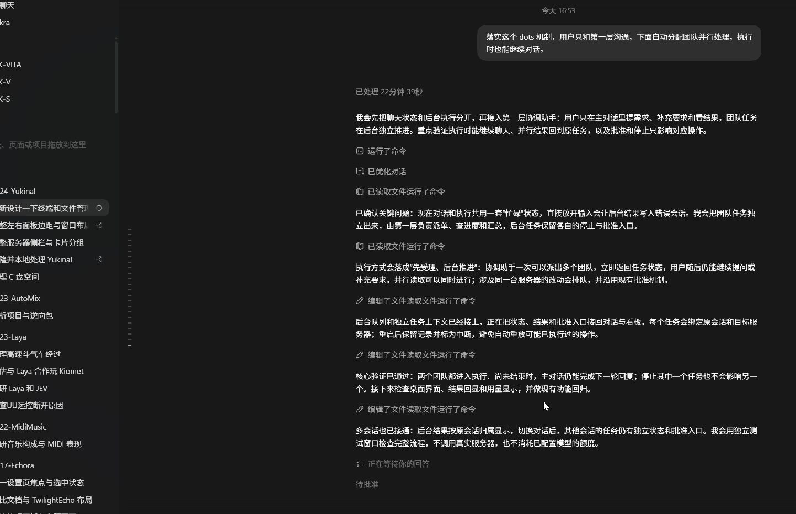

# Dots 协调机制：实施与验收

日期：2026-10-17。工作分支：`codex/ui-layout-direction`。

## 现在可以怎样使用

用户始终与“协调助手”对话。普通问题直接回答；需要独立执行的工作，由协调助手按已配置角色选择蓝队、黄队等，在后台创建独立任务。各队沿用自己的模型绑定；未绑定时使用本次主对话模型。需要使用支持工具调用的模型。

分派后立即返回，团队继续处理，主对话可继续提问和补充。结果、问题、批准请求回到原对话，四列看板和任务属性同步显示。用户可以停止单个团队，其他任务继续。界面收起内部调度回执，保留实际任务、结果和批准信息。

每项后台工作使用独立执行会话，不复制整段主对话。后续主对话自动获得任务状态和结果摘要，协调助手可以查询实际进展并汇总。结果到达使用状态事件直接更新界面，不额外调用模型逐条播报。

## 执行规则

| 项目 | 当前实现 |
| --- | --- |
| 并行容量 | 全局最多 3 个后台团队运行；主对话不占用这 3 个后台名额 |
| 分派规模 | 单次工具调用最多 4 项；单轮最多新建 8 项；每段对话最多 8 项在途；全局最多 32 项在途 |
| 同一目标 | 只读任务可并行；变更任务独占该目标，等待变更期间不插入新的读取；不同目标可以同时工作 |
| 范围 | 冻结受理时服务器、模式、权限、角色和模型配置；单服务器对话不能分派到其他服务器 |
| 多服务器 | 明确引用多个服务器时保留全局会话，由每个任务指定实际目标 |
| 权限 | 团队身份不增加权限；只读和计划模式不能通过委派写操作；子任务不能递归派队 |
| 批准 | 保留原工具审批；每个批准绑定原运行和批准编号；不因切换服务器或会话而转移 |
| 去重 | 任务 key、原会话和上下文版本确定任务身份；相同内容重试返回原任务，冲突内容被拒绝 |
| 恢复 | SQLite 保存任务及结果；重新打开可查询。运行服务重启后未完成任务标为中断，不自动重放变更 |
| 多会话 | 所有后台任务由窗口级订阅接收；当前对话看自己的结果，其他对话的在途任务有独立状态和批准入口 |
| 用量 | 按运行累计供应商实际返回的输入输出，重复状态不重复相加；缺失上报显示未知，部分缺失显示已知下限 |
| 心跳 | 继续使用统一 30 秒刷新点汇总状态和用量；刷新本身不创建模型请求 |

看板继续保持四列、16:9 卡片。任务运行沿用团队颜色的描边反馈，等待批准显示静态状态。运行返回标为“已返回”，避免把一轮模型结束等同于部署目标已验证完成。

## 实际验证

- 桌面完整测试 358 项、共享协议测试 135 项通过，桌面类型检查与构建通过。
- Python 代理完整回归 161 项：157 项通过、4 项按原条件跳过。新增验证涵盖真实 LangGraph 执行链中的团队并行、前台继续对话、独立取消、目标冲突排队、两份独立批准、拒绝跨运行批准、任务恢复、上下文隔离和配置边界。
- C++ 宿主 IPC 与 sidecar 测试各 1 项通过。
- 使用隔离的真实桌面窗口、独立数据库和本机确定性模型服务验证：蓝队、黄队都进入运行后，主对话完成第二轮回复；看板同时出现两张进行中任务；结束后两份结果保存并回到原对话，重新打开对话及属性仍可查看。
- 桌面验证没有连接真实服务器，没有调用用户配置的外部模型，也没有使用或修改用户的模型密钥。

第一张记录调整内部回执展示之前的真实并行过程；最后一张为收起内部调度细节后的最终对话界面。

## 当前边界

这是一次性后台团队执行机制。持续“盯着”的持久循环调度、应用关闭后的常驻执行，以及检测到异常自动唤醒团队，仍需接入真实调度服务。协调助手明确不能把一次分派说成已经建立循环。

现有宿主对部署、删除等操作的计划绑定、预算和审批继续生效。缺少必要计划或权限时团队会报告问题，不绕过限制。此次没有验证真实服务器部署。

当前展示按运行累计的已上报用量；尚未实现供应商每次计费尝试的完整账本、全父任务的费用预留和硬性 token 总预算。供应商内部重试或未返回的用量不能当作已知费用。

模拟服务器模式保留界面演示和纯对话能力，不启动真实团队操作。退出模拟模式后使用已登记服务器和真实协调执行。
