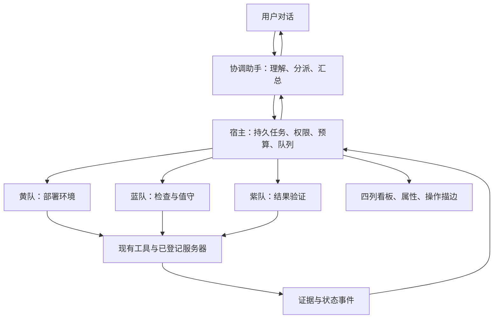

# 统一协调助手：Dots 体验与 Yukinal 接入研究

日期：2026-10-17。范围：当前桌面新版。本文件保留最初研究与完整目标；协调助手、有界后台团队并行和执行期间继续对话现已落地，见[实施与验收记录](./dots-coordinator-implementation-20261017.md)。下文中的接入阻碍和实施建议是实施前记录，持续调度、完整计费账本等仍属后续工作。

## 结论

建议增加一个用户始终面对的“协调助手”。它负责理解目标、分配任务、接收结果和请求用户决策；黄队、蓝队等作为它可调度的执行能力。用户无需进入每队的聊天，也不必了解每次用了哪个模型。简单问答由协调助手直接完成，涉及服务器执行时再创建独立任务。

这与用户描述的“第一层向下调用，用户只沟通这一层”一致。这里借鉴 Dots 的交互与职责组织，不声称复刻它未公开的内部架构，也不要求绑定 OpenAI 模型或迁移现有供应商。

## 官方资料确认了什么

| 资料 | 可确认的公开行为 | 对 Yukinal 的启发 |
| --- | --- | --- |
| [Meet dots](https://learn.chatgpt.com/docs/dots) | 用户可在工作继续时沟通、补充要求、调整优先级，助手带回结果与决策请求 | 对话和执行分别推进，统一对话者保持连续 |
| [Tasks and memory](https://learn.chatgpt.com/docs/dots/tasks-and-memory) | 可分派后台代理并行工作；新任务有独立对话，只接收所需上下文；固定重复工作需要保存计划 | 协调层、子任务、记忆和定时计划分别管理 |
| [OpenAI Docs：Orchestration and handoffs](https://developers.openai.com/api/docs/guides/agents/orchestration) | “代理作为工具”让协调者保留最终答复责任；handoff 则把回复责任交给专家 | 用户只和协调助手沟通时，采用前一种责任划分 |
| [OpenAI Docs：Multi-agent](https://developers.openai.com/api/docs/guides/agents-api/multi-agent) | 子代理具有独立上下文，可并行完成独立问题，再由主代理组合结果 | 子任务传目标、证据和边界，避免复制完整聊天 |

资料说明产品行为与公开编排接口，没有证明 Dots 内部固定采用几层模型、每次请求如何路由或具体 token 节省比例。以下接入方案是结合当前代码作出的设计判断。

## 三个层次，各有责任

协调助手是可以配置的一个模型角色，优先保证理解、工具选择与简洁沟通。它只获得任务创建、查询、补充、停止和计划管理等管理能力，不直接获得任意 SSH 命令、凭据或审批绕过能力。用户选中的模型可作为其默认模型；团队继续使用已有模型绑定。需要独立选择时才新增一项“协调助手模型”，不添加强制模型组合。

宿主负责执行约束：校验结构化任务、冻结目标服务器和授权、登记任务、排队、恢复、记录请求用量。模型建议不直接成为权限或持久事实；白队可参与评审，但模型评审不能代替宿主的权限检查。

团队代表职责和工具边界，不代表七个模型必须常驻。一次部署先交黄队；只有验证确实独立时再交紫队，检测到安全异常时再调用蓝队。短问答不分队，连续相关步骤可在同一执行任务中处理，避免层层复述。

## 一次请求怎样流转

以“给这台服务器安装 Node，然后帮我盯着”为例：

1. 协调助手从明确服务器引用和发送时的界面语义快照解析目标，生成部署目标与持续检查要求。无法确定主机时先澄清；普通页面点击不会自动触发模型。
2. 宿主登记父任务、黄队部署子任务及任务范围。派发工具迅速返回任务 ID 和真实受理状态，协调助手可答“黄队开始检查环境，完成后验证并建立值守”。此时不能承诺部署已完成。
3. 后台执行在独立子会话中继续。用户可在主对话补充“使用 Node 22”，该指令成为目标修订；已执行或正在变更的步骤在安全边界处理修订，不盲目重放。
4. 工具事件直接更新卡片和描边。需要批准时，主对话展示原任务、目标、操作与影响，批准绑定原 run/call，不随当前选中服务器改变。
5. 执行返回结构化事实、证据、失败或未知项。验证通过后，协调助手给出简短结果；已明确要求的值守登记独立计划，并显示已保存的间隔、检查范围和通知策略。
6. 正常且无变化的检查静默更新状态；出现新异常或需要决策时才唤醒协调助手整理说明。用户说“停止这个部署”和“取消后续值守”分别作用于运行与计划。

用户只面对一个协调助手，仍可打开团队、任务属性和原始证据。沟通统一不会隐藏执行者、实际目标、风险或未完成的验证。

## 对话保持可用，后台各自隔离

协调助手的一次用户输入按顺序受理，但一次任务分派不持续占着对话请求等待后台执行。后台结果进入有序事件收件箱；完成、失败、阻塞和待批准可唤醒下一轮，普通工具进度采用界面模板，无需每条事件再次调用模型。

每个委派至少冻结这些字段：`parentTaskId / taskId / parentRunId / runId / sessionId / serverId / teamId / goal / scopeRevision / authorizationRef / modelRef / budget / idempotencyKey`。可见标题建议单独保存为短 `title`，原始目标保存在 `objective`；标题突出动作与对象，服务器在卡片底部单列，不为了生成标题多发一次模型请求。旧任务仍展示已有目标，不自动改写记录。

子任务只接收必要目标、验收条件、相关事实与证据引用，不继承完整用户聊天或其他服务器记录。模型结果应返回实际状态、完成项、证据引用、尚缺信息、所需决策与已上报用量；宿主核对关联后再投影到界面。日志、网页和子任务输出都是材料，不能反过来扩大协调助手的权限。

“统一助手”也不等于所有会话共享一条无界历史。每段用户对话保留自己的目标和可见记录；跨任务只按明确关联获取摘要。用户说“这个怎么样了”优先绑定当前引用的任务，多项候选时提供简短选择。

同一服务器上的只读检查可以有界并行；安装、重启、文件写入和未知命令先使用主机级变更锁。不同服务器分别校验范围后可并行。协调层保留前台模型名额，避免后台部署占满请求槽位，导致用户无法继续沟通。

## 当前代码的接入位置与阻碍

本轮重新核对了下列入口，其余并行边界沿用[现有并行研究](./parallel-sessions-design-20261017.md)。

| 位置 | 当前事实 | 接入前必须完成 |
| --- | --- | --- |
| `useAgentRun.ts` | 单个 `RunLifecycle` 和一组受理、回复、批准状态 | 把运行状态与事件订阅移入按 run/session 索引的窗口级目录，聊天组件只订阅所需投影 |
| `useChatSessions.ts::recordAssistantMessage` | 回复写入时读取当前活动 session ref | 按受理时冻结的 session 和稳定消息 ID 写入，晚到结果不能写入新打开的对话 |
| `model_agent.py` | 单执行器工具调用默认串行；已使用 LangGraph 工作流 | 在现有 Python 执行层增加有界委派管理工具，保留每个子执行器的工具策略，无需为了此模式换 SDK |
| `model_agent.py` | 模型节点使用 `ainvoke` | 真正文字增量需要供应商流式适配，不能把任务进度事件当成模型 token 流 |
| 现有任务 / 看板 / 团队运行 | 能投影持久任务与本窗口运行，暂无完整后台自动派发目录 | 补齐持久父子关系、已知团队、状态事件和恢复查询，再开放自动团队路由 |
| 心跳与用量 | 当前 UI 有统一刷新点，已有已登记计划展示 | 后台调度器与请求级账本单独接通，UI 定时刷新不承担执行职责 |

父任务与子任务不能共用会被父执行器一直持有的会话锁，否则父任务等子结果、子任务等同一把锁会相互阻塞。采用独立子会话，并让派发迅速返回；子结果通过任务事件回到协调助手。

不应通过解除现有 busy 限制直接实现“边执行边聊天”。应先解决运行归属、回复落库、断线恢复和资源队列，再允许对话与后台任务同时推进。

## token 与统一心跳

协调层本身会增加一次路由或汇总的输入输出。能否降低总 token，取决于子任务上下文大小、重复汇总次数与是否避免无意义模型轮询，不能预先承诺节省。

建议沿用统一心跳：基准 30 秒，5 分钟的计划每 10 拍到期。调度器先用普通采集和确定性规则判断变化，只在出现需要理解、调查或决策的新信息时申请模型。每个计划有独立 due time、执行租约和恢复规则；错过多拍时合并一次检查，上一轮未结束时不重复启动。可按计划错开到期相位，避免所有主机同拍挤占模型与网络。

用量按实际供应商请求落账：每个真实请求尝试有唯一 request/attempt ID，关联父任务、具体运行、模型和供应商。协调请求与团队请求分别统计，总计只把叶子请求加一次，不把父任务汇总与子任务用量重复相加。重试若确实发出第二个计费请求，记录为第二次尝试；未上报和取消后结果未知不能写为 0。

心跳只刷新账本的展示聚合，不决定收费事实。一个请求跨过刷新点仍只落账一次；计划到期但没有模型请求时模型 token 为 0，模型已请求但尚未报告时显示未知或待结算。派发前预留父任务总预算，包含协调与所有子项，超额进入可见暂停状态，不能每队各自拿一份完整父预算。

## 与四列看板和属性窗口配合

四列继续表示待处理、进行中、待确认、已结束。主任务卡展示短标题和聚合状态，团队子项进入属性窗口按团队、目标、证据列出；确需独立跟踪的子目标可单独成为卡片。一次模型输出结束不直接等于主目标已完成。

工具开始时，事件中的实际团队点亮对应服务器、工具入口、任务卡和左侧看板。等待批准使用静态标记。主对话只播报有意义阶段与决策，不让七队逐条刷屏；完整工具动作仍可检查。沿用现有小圆角卡片和单层属性浮窗，不增加新的嵌套框。

协调助手离线时，已持久化的计划是否继续取决于实际宿主服务。当前桌面实现不能承诺关机后继续值守；需要常驻本地服务或远端执行宿主后才能提供该能力。

## 建议实施顺序与验收

1. **先分离运行与视图。** 完成显式会话落库、统一运行目录、事件去重与恢复。验证切页、切服务器、断线和旧结果晚到都回到原任务。
2. **增加协调助手与单队委派。** 先支持一次部署或一次只读检查，结构化派发、暂停、继续和具名证据返回。验证无效目标、重复受理、等待批准、子任务失败、预算不足和协调模型不可用。
3. **开放有界并行。** 验证两个不同服务器可同时工作，主对话可继续提问；同主机冲突变更排队，只取消一个子项不会停止另一个。目标修订在正确任务生效。
4. **接入持续计划。** 验证每 10 拍的计划、应用重连、漏拍合并、单轮去重、暂停计划与停止当前运行、正常状态静默，以及请求跨心跳边界不重复计费。

本轮研究没有创建真实计划、自动连接服务器、运行供应商模型或启用新的后台权限。现有会话与配置保持原样。
