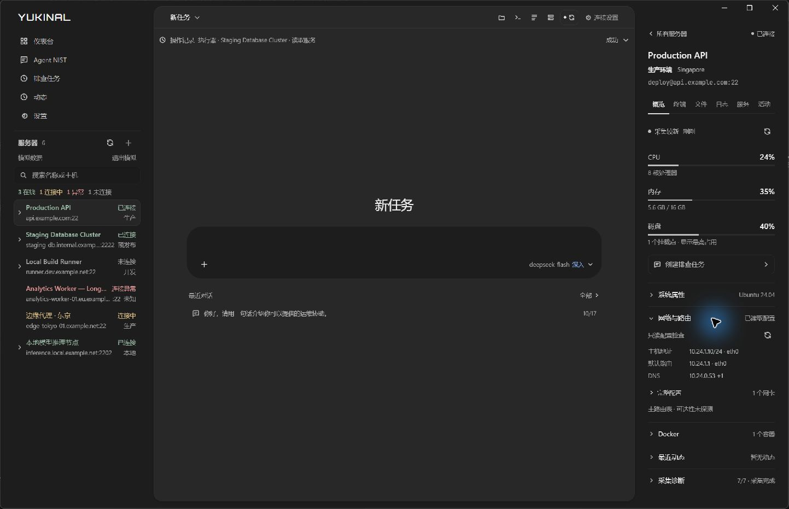

# 运维工作区对比与本轮落地

调研日期：2026-10-17。依据产品官方页面与用户文档；下述差异是本项目当前实现的检查结果，不是竞品功能穷举，也不推断其他产品没有 AI。

| 产品 | 官方资料中可确认的做法 | 对 Yukinal 的启发与当前差距 |
| --- | --- | --- |
| [Cockpit](https://docs.cockpit-project.org/cockpit-guide/latest/guide/feature-networkmanager.html) | 通过 NetworkManager / D-Bus 管理网络，沿用系统权限；明确哪些设备由 NetworkManager 管理。 | 把网卡、IP 与路由当成主机事实，不把 SSH 已连接当作外网可达。Yukinal 本轮加入只读配置检查；不提供网络配置修改。 |
| [1Panel](https://1panel.pro/docs/v2/user_manual/system/monitor/) | 监控包含负载、CPU、内存、磁盘 I/O 和网络 I/O，可选择历史时间并设置采集间隔、保留周期。 | Yukinal 目前主要是当前快照与任务证据，不能把累计字节伪装成实时速率或历史趋势。本轮明确累计流量，并继续使用快照时间与缓存状态。 |
| [Termius](https://termius.com/) | Hosts、Groups、SFTP、Port Forwarding、Vault / Keychain 组织连接资产；Restore Workspace 可把多连接分组并恢复工作区。 | 服务器资产索引与当前工作区的会话切换分开。Yukinal 最近对话移到 AI 面板，仍按全局/服务器范围检索；终端、文件继续通过中间工作页打开。 |

## 本轮已实现

- 最近对话位于空白 AI 对话输入区下方，最多三条；标题菜单保留完整历史搜索、归档、重命名与删除。左侧只留服务器导航。切换历史保留草稿，读取中禁止重复打开；切换服务器后拒绝展示旧范围晚到的结果。
- 服务器概览增加折叠的“网络与路由”：主机地址、默认路由和 DNS 三项只读配置检查；展开查看网卡状态、IPv4 / IPv6 地址、主路由表、网关、优先级、resolv.conf 与累计流量。
- SSH 快照增加固定只读命令：`ip -j address show`、`ip -j -4 route show table main`、`ip -j -6 route show table main`、`cat /etc/resolv.conf`。每节独立降级，缺少 iproute2、权限不足、解析失败与成功返回空配置分开表达。旧服务未返回扩展数据时显示“未采集”。
- 网络信息是配置快照，不等于探测成功：默认路由只检查可转发的默认项；本机 DNS 代理不会被当作已知上游 DNS。没有进行 ping、traceroute、DNS 查询或公网出口探测；策略路由/其他路由表不在本轮主路由表视图内。
- 模拟数据覆盖配置完整、无默认路由、读取失败三个场景，不会向样例服务器发出真实请求。

## 尚存的实际边界

C++ 桌面宿主仍处于迁移阶段，`server_snapshot` 等服务器命令尚未由桌面 IPC 路由器完整实现；本轮扩展的是共享响应契约、SSH 固定快照工具、Python 正规化和真实前端展示，不宣称模拟窗口证明了真实服务器连接。实际 Linux 主机仍需接通桌面服务器 IPC 并验证命令权限后才能形成原生端到端验收。现有 [迁移计划](./rust-removal-plan.md) 记录宿主能力边界。

优先顺序：先接通只读服务器链路和失败反馈，再考虑时间序列监控、组/标签索引与明确目标的路由探测。保持 AI 对话为工作入口，右侧提供可追溯的事实，不堆叠与当前任务无关的控制面板。

## 本轮验证

桌面测试 323/323，共享响应契约 135/135，相关 Python 协议/快照/sidecar 测试 52/52；类型检查及生产构建通过。浏览器已核对默认路由缺失与两种地址族路由读取失败，页面无横向溢出。实际原生窗口已验证最近对话的打开、草稿恢复及三行网络摘要。没有执行真实 SSH、ping、traceroute 或 DNS 请求；本轮未重新构建独立 C++ SSH 服务，新增四条固定命令还需要随服务构建和真实主机一起验收。

