# 界面表达与皮肤约定

> 当前交互基线为 `2.0.1`（2026-10-27），以[工作区交互说明](./workspace-tabs-spec.md)为准。下文带日期的截图与验收段落为历史记录。

## 统一的表达

圆角半径越大，视觉越圆润；几何上的曲率反而越小。因此后续用「圆角半径加倍」来表达这次从 8px 到 16px 的调整。

| 名称 | 对应元素 | 当前规则 |
| --- | --- | --- |
| 外窗 | Windows 窗口边界、系统按钮 | DWM 管理，普通窗口约 8px；最大化时由系统变方 |
| 主面板 | 中间 AI 内框、输入面板 | 16px 圆角 |
| 卡片 | 服务器、用户消息、弹层容器 | 12px 圆角；设置使用无外框平铺分组 |
| 控件 | 按钮、输入框、选择器、导航项 | 8px 圆角 |
| 标记 | 状态标签、文字高亮 | 4px 圆角；细指示线用 2px |
| 胶囊 / 圆形 | 胶囊按钮、状态点、圆形工具 | 保留胶囊或正圆的用途 |

例如「卡片再圆一点」「控件更紧凑」「主面板边线再淡一点」「浮层阴影更轻一点」，都指向对应的共享规则。统一的是层级与材质语言，圆形状态点不随面板半径变成圆角方块。

## 单一声明入口

- `apps/desktop/src/styles/design-tokens.css`：圆角、字体、控件高度、内容密度、焦点环尺寸、禁用透明度。
- `apps/desktop/src/styles/materials.css`：默认石墨材质的底色、文字、状态色、描边、表面覆层、阴影与高光。
- `apps/desktop/src/styles/typography.css`：字号层级与文字排版。
- `apps/desktop/src/styles/workspace-motion.css`：动效时长、曲线、减少动效规则。

组件与页面仅消费这些变量；不新增局部十六进制颜色、固定圆角或独立阴影配方。边界连接允许 `0` 和 `inherit`。布局尺寸、业务状态与层级关系仍由对应组件负责。

## 材质层级

底板使用 `--bg`；AI 主面板使用 `--workspace-content-surface: #282828`；卡片使用 `--panel-raised`；输入区与文本编辑区域共用 `--composer-surface: #1d1d1d`，取自用户最新提供的色样，以描边标明输入范围。它们属于同一套不透明石墨材质，以明度、淡描边和轻阴影区分层次。

交互使用 `--material-rest/hover/active`；凹入区域使用 `--material-inset`；浮层遮罩使用 `--material-scrim`。表面覆层与阴影通过高光、暗部两个 RGB 基色派生。成功、警告、错误等状态保留语义变量。

主面板、卡片、凹入、浮层使用各自的阴影变量；外框到内框继续使用轻阴影。AI 输入框保持平面，默认、聚焦与拖入附件时均无阴影、光圈或渐变，只改变细边线表达状态，文本框与输入面板底色始终一致。发送按钮使用 `--on-accent`，避免浅色按钮底和浅色文字叠在一起。

## 标题与界面文字

各面板不在窗口顶部重复显示名称，浏览器和窄窗口也不补回标题；当前页面由左侧选中导航、服务器视图标签和区域无障碍名称表明。原生窗口切换信息继续保留。宽窗口在原生顶部确认同步成功、运行时支持标题栏区域后，将中间工作区工具行移入标题栏；空白处支持原生拖动、系统菜单和双击最大化，按钮保持正常点击。系统窗口按钮与顶部缩放边缘由宿主保留；左侧品牌与工具行对齐，右侧保持原有顶部留白。窄窗口与不支持的运行时保留独立原生标题栏。同步失败时保留完整圆角。设置按偏好、模型、工具、网络、诊断分区，区间切换保留未保存的输入。

界面使用具体操作和真实状态，删除欢迎口号、重复说明与闪光装饰。表单标签、错误、权限确认、保存反馈和必要的安全边界继续保留；模型生成的内容与用户数据不参与文案替换。

## 页面编排

参考《Apple-Music-Windows 设计比例与巧思 v1.1》的分组、对齐、密度与内容预算原则。文档中的推导值和迁移建议是参考值，不作为平台强制规范。

| 页面 | 首层内容 | 按需展开 |
| --- | --- | --- |
| 对话 | 对话正文、输入、图标工具、模型选择 | 历史、角色与权限菜单、中央工作页 |
| Agent NIST | 队伍、角色职责、绑定的模型连接、记忆库入口 | 本机角色编辑、选择后续对话角色、全局与服务器记忆 |
| 服务器概览 | 当前目标、环境与连接、采集新鲜度、三条资源读数 | 系统属性、容器、最近活动、采集诊断 |
| 排查任务 | 任务列表、选中任务的目标与状态 | 新建表单、执行边界、巡检、证据与阶段记录 |
| 动态（默认） | 时间、动作、目标与结果 | 具体执行步骤、记录详情 |
| 服务 / 日志 | 来源与数量、状态列表 / 原始日志 | 长文本换行、保留原始内容 |
| 文件 | 路径导航、文件列表、上传入口 | 文件预览、本机队列、传输记录 |
| 设置 | 偏好、模型、工具、网络、诊断 | 模型高级连接选项、运行日志 |

列表页用共享 `PageToolbar` 放数量、来源和操作；正文使用同一组间距与卡片材质。页面样式分别由 `reference-pages.css`、`files.css`、`investigation.css`、`providers.css` 管理。

设置例外使用 `settings.css`：无圆角卡片、无悬停抬升，以分组标题、间距和分隔线组织表单。界面字号、密度和动效固定使用产品默认值，不提供调整入口，也不读取旧版界面偏好。偏好仅保留终端、任务批准并自动保存；恢复默认值仅影响本页偏好。模型保留连接选择与显式保存，高级连接选项默认收起；工具保存不等于授权或启动；网络标明未保存修改和下次连接生效；诊断集中只读状态、恢复信息和日志。

左右辅助面板共用 `--workspace-side-width` 与 `--workspace-side-inset`：三栏窗口的侧栏最小宽度 280px，固定边距 24px；左侧品牌、服务器标题、搜索、列表与右侧页头、视图切换、正文按同一边距起止。对话面板填满中间网格列，不再通过百分比宽度额外叠加留白；两侧内容距窗口边缘和对话面板的距离一致。右侧正文为滚动条预留位置时扣除对应宽度，保持实际内容的左右留白相等。

左侧主导航依次为动态、Agent NIST、排查任务、设置；动态替代仪表台，并作为默认参考页面。品牌删除图形 Logo，使用本地打包的 Orbitron 字体文字标识，字体附带 OFL 许可。支持标题栏覆盖的宽窗口将文字标识与中间工具行对齐，该区域可拖动窗口。服务器数量、刷新和添加集中在分组标题行；左侧底部不再放全局对话和记忆库入口。

中间 AI 区参考 [Codex 官方演示](https://www.youtube.com/watch?v=HFM3se4lNiw) 的留白和简洁输入区，具体尺寸适配三栏窗口，并非官方测量值。消息与输入框共用最大 760px 的阅读列，正文与输入文字为 12px，正文行高 1.6、输入行高 1.5，消息间距 18px；空态标题居中，删除三个任务建议入口；已有消息时输入框停留在底部。用户消息靠右，AI 回复平铺正文，显示实际参与者和模型署名。输入区保留文字与一行工具：附件、权限、范围和运行状态用图标表达，模型选择与发送／停止直接可见；图标提示保留真实范围与状态。批准方式使用独立菜单，角色、只读限制和策略收进运行设置，主界面不再常驻特殊模式或自动匹配选择器。实际错误与恢复操作仍在输入框内显示。点击范围图标可从服务器对话返回全局，草稿分别保留；底层权限和请求约束继续生效。

右侧保持辅助面板，不提供展开按钮。内容以自身可用宽度重排：窄时单列、长文本换行；小窗口使用现有的对话 / 参考区域切换，较宽参考区域允许并排字段。收起任务创建表单保留输入，不自动授权或启动。

左侧主导航使用 32px 行高。服务器列表参考 [VS Code Remote Explorer](https://marketplace.visualstudio.com/items?itemName=ms-vscode.remote-explorer) 的远程目标列表思路，按本项目的信息预算保留名称、连接地址和状态：首行名称使用中性文字，右侧以实心点、空心点、连接符号和警告符号区分四种状态；第二行显示主机，仅非默认端口额外显示。移除每行重复的状态文字、环境标签及顶部状态汇总；环境仍可搜索，并在详情、完整提示和无障碍名称中保留。保持侧栏原宽度与 24px 内容边距；长名称和主机可省略，非默认端口不省略。

服务器标题行显示总数；筛选时显示匹配数/总数。开发模拟入口收为同一行的“模拟”按钮，不另占一行。悬停或键盘聚焦时在地址行右侧显示“更多”，展开连接/断开、编辑与删除；菜单支持方向键、Escape、外部点击和焦点返回，触摸设备常显入口。服务器是父对象，已检测的 Docker 与容器以子层级展开；仅展开已连接且主机身份已核验的节点时读取快照，失败、未连接和未知状态分别呈现。

动态默认展示全局活动流，按本地日期从新到旧分组为今天、昨天和具体日期。右侧使用平铺时间流，取消整组卡片外框；每条首层只显示动作、真实结果、目标和时分，长标题最多两行，目标可省略并保留完整提示。整行可通过点击或键盘展开，详细说明、原因、执行者、完整时间和工具步骤按需读取与显示；没有工具追踪的记录仍可展开说明。顶部使用“全部 / 异常”数量筛选和单个刷新图标，“异常”只包含失败或被拒绝，取消不算异常。无动态、无异常和读取失败保留真实反馈。沿用原有侧栏宽度与滚动区，中央工作页和右侧临时对话卡片的位置规则保持一致。

主导航保留“动态 / Agent NIST / 设置”，移除“排查任务”入口及概览里的创建按钮；旧视图发起的任务导航回到动态。既有任务记录仍保留，服务器资源读数保留在所选服务器的概览内。点击“动态”只切换参考页面，保留当前服务器目标、草稿、模型与服务器页面状态。

Agent NIST 位于动态下方，按蓝、红、紫、白、黄、橙、绿七队组织十四个本机角色。蓝队负责防守与响应，红队负责授权攻击测试，紫队负责红蓝检测共建与复测，白队负责范围、规则与风险控制，黄队负责设计开发，橙队负责红黄协同修复，绿队负责蓝黄可观测性与响应设计。窄侧栏使用两行队伍选择，宽面板使用单行；角色只保存名称、职责、Provider ID 与模型 ID，不保存 API 密钥。旧目录升级保留自定义内容与模型分配，模拟预览使用独立配置。选择角色将职责作为后续请求的 persona 系统提示并选择对应模型，不向草稿注入职责，不自动发送或改变批准策略。同一对话支持逐轮换角色并共享证据；显式子参与者 API 不等于自主调度或默认并行运行。

对话历史、草稿和工作上下文按服务器分开；未选服务器时使用全局范围。记忆库入口位于 Agent NIST，区分全局与当前服务器，提供显式保存、搜索、编辑和删除，使用 FTS5 词项检索，不标称向量 RAG。对话输入由预算内的完整近期轮次与有界归档摘录组成。单会话重置开启新的工作上下文；重置全部状态还会清空当前草稿和临时视图，两者均保留历史、记忆和连接配置。记忆库使用模态对话框约束焦点，关闭后恢复到入口。架构细节见 [团队上下文架构](./team-context-architecture.md)。

对话文字构成基础层；打开文件、终端、日志、服务与证据时，中央信息层使用中间工作区。宽窗口中的同一份 AI 对话升为浮动卡片，临时借用右侧参考栏，保留四周留白与原栏内容，初始居中；打开、展开或收起信息层均沿用现有三栏宽度。卡片标题支持上下拖动，右下角支持调整大小，操作范围限制在借用区域内；“居中”保留调整后的大小，“返回中间”收起信息层并恢复原对话位置。窄窗口沿用原有布局，在中间工作区内安排信息与对话。

中央工具栏固定提供文件、终端、日志、服务四按钮，直接切换单一主视图。移除额外标签栏、加号、分栏、停靠、展开和返回对话操作；Agent 对话在右侧浮栏继续。未选目标时显示选择提示；切换目标后当前工具跟随服务器，旧终端会话保留。工具记录按选中服务器过滤，显示真实执行者、目标、动作、状态和时间。详细规则见[工作区交互说明](./workspace-tabs-spec.md)。

工作页工具栏位置稳定，不随弹层开合移动。Token/上下文控件为 28px，详情通过锚定弹层展开，不占据状态行空间。浮栏输入工具条的附件、可省略模型名、设置和发送/停止同一行，控件为 32px。用量、模型、推理与设置弹层受视口约束，使用 top layer 避免裁切，支持 Escape 和外部关闭。

终端和日志打开时不显示说明段落与重复工具提示；未绑定服务器的工作页显示选择服务器提示，加载通过无文字进度指示表达，读取失败仍保留原因和重试。终端使用平整工作面：内容区平整铺开，底部细状态栏显示真实目标地址与编码，不重复嵌套带边框的终端容器。

文件面板参考 [WinSCP Explorer](https://winscp.net/eng/docs/ui_explorer) 的路径栏、文件列表与传输队列结构。路径、上级目录和刷新集中在一行；紧凑文件行显示名称、类型和大小，支持目录内筛选及排序，目录优先。选中文件后按需展示预览，关闭后恢复完整列表宽度；窄面板将预览排到列表下方。本机文件与传输记录位于可展开底栏，有进行中的传输或待解决冲突时自动展开传输区。保留现有上传、下载、拖放、冲突处理和失败信息，不增加无数据来源的日期、权限等列。

底层保留原生独立窗口能力，当前中央工具栏不提供弹出入口。独立窗口共享宿主 router 与事件来源。独立终端创建自己的 PTY；独立窗口收起可重开，主窗口退出时统一结束。置顶使用操作系统 topmost，收到成功回执才更新状态，失败在窗口内显示；浏览器不显示原生置顶能力。

Markdown 不执行原始 HTML；产物以经过结构校验的图表、流程图或安全文本展示。HTML 保留源码视图，原生交互运行暂时禁用，用户点击时显示简短原因。无原生桥的浏览器预览可显式启用 sandbox，不作为原生隔离验收。

服务器详情按对象检查器组织：目标全名、环境、区域与连接地址常驻滚动区上方，概览与活动两个参考视图用单排文字标签切换并保留键盘导航；文件、终端、日志、服务统一从中央工作页打开。概览首屏展示采集新鲜度、CPU／内存／磁盘读数及一个创建任务入口，不附加健康等级。系统属性、容器和采集诊断通过分隔线与可展开摘要组织，异常采集和缓存状态继续明显展示。服务器能力标签来自实际检测结果，不从名称推断；PVE 检测待实现。

内容适配以面板宽度为依据：280px 参考栏中的设置、任务、文件和资源按单列排列，较宽参考区恢复并排字段。设置标签均分可用宽度；长模型、工具、目标、路径和错误说明允许换行，操作按钮按组换行。代码、终端与不可拆分的授权码在自身区域内滚动，不撑开整个页面。文件导航与路径保持同一组，窄面板中的上传操作换到下一行。

紧凑窗口侧栏宽 240px，服务器沿用双行身份与单个“更多”入口。对话记录的标签均分列宽；模型菜单定位在输入面板上方，名称和来源分行，键盘选项变化时滚入可见区域。添加／编辑服务器弹窗固定关闭区和底部操作，长认证表单独立滚动，短窗口也能访问表单末尾。

草稿文字与附件可在运行服务或模型未就绪时先行准备；发送仍以桌面连接、服务、事件监听和模型就绪为条件。运行中与已归档会话继续限制编辑，普通 Enter 换行，Ctrl+Enter（macOS 为 Command+Enter）或发送按钮提交；未就绪时保留普通消息草稿。中文输入法确认优先于候选补全与发送。

## 模拟数据评估

开发预览在左侧服务器标题行提供「模拟」按钮，以按下状态表示正在使用模拟数据，也可使用 `?fixture=1`。包含 6 台服务器，覆盖中英文长名称、非默认端口、生产/预发布/开发/本地环境，以及已连接、连接中、未连接、连接异常四种状态。已连接服务器显示 CPU、内存、磁盘与容器样例，预发布数据库包含磁盘 92% 的高占用样例。

评估数据还覆盖长名称模型来源、MCP 运行／待授权／退出状态与工具审查、带证据和巡检记录的排查任务、含表格和长代码行的对话，以及长路径文件预览与成功／失败／冲突传输记录。共享响应 schema 校验 IPC 返回契约、样例关联、不支持的操作，以及重复轮询后的时间状态。概览以快照接收时间作为显示时钟下限，避免新数据被旧时钟误判为来自未来。预览文件传输等写操作明确返回不支持，不伪造执行成功。

模拟数据只在当前页面内存中存在，连接、断开与删除只改变样例，刷新可复原；所有模拟请求由本地适配器处理，不调用真实业务接口或订阅真实服务器事件。AI 可以编辑草稿，禁止发送模拟目标到真实 Agent；真实数据与配置不会被写入。切换模式需要先完成或清空草稿，避免刷新丢失输入。该入口仅在开发预览显示。

## Claude Design 社区资料参考（2026-10-16）

本次阅读了 [Open CoDesign 的 Claude Design 提示结构研究](https://github.com/OpenCoworkAI/open-codesign/blob/466e64d199909f3d06e78860075d62febd24fc8a/docs/research/15-claude-design-prompts.md)、该项目当前的 [界面表达原则](https://github.com/OpenCoworkAI/open-codesign/blob/466e64d199909f3d06e78860075d62febd24fc8a/apps/desktop/resources/templates/skills/frontend-design-anti-slop.md) 和 [细节验收方法](https://github.com/OpenCoworkAI/open-codesign/blob/466e64d199909f3d06e78860075d62febd24fc8a/apps/desktop/resources/templates/skills/craft-polish.md)，并对照了 [Claude Design System Prompt](https://github.com/Trystan-SA/claude-design-system-prompt/blob/main/codex/system-prompt.md) 的内容、层级、色彩、交互与组件章节。这些是社区研究与整理，不是 Anthropic 发布的官方界面规范。Open CoDesign 也明确将结构研究与其自行编写的实现分开。

落实到 Yukinal 的规则：

- 主任务优先：中间保留正文和输入，辅助信息用字号、字重、对齐和间距降低权重，不靠装饰争夺注意力。
- 共享规则优先：颜色、间距、圆角、图标与状态反馈复用现有变量及组件，页面不各自建立一套视觉参数。
- 内容必须有用途：不补回重复面板标题，不用欢迎口号、假数据或装饰卡片填空态。
- 状态可理解：输入、发送、禁用、加载、错误分别表达；离线可准备草稿，无法发送时保留原因与恢复入口。
- 简洁仍可操作：保留键盘焦点、标签、模型与权限信息；AI 输入框用细边线表达焦点，不增加发光效果。
- 修订保持连续：保留现有三栏结构、固定外观与真实能力，按实际窗口核对变化。

社区材料包含面向营销原型的建议；其中强制增加光晕、渐变、装饰动画、虚构指标或外观调整面板的做法不适用于本项目。字体、尺寸和密度仍按中文 Windows 桌面场景与本项目现有约定选择。

## 模型、批准方式与推理强度

模型与推理强度共用输入框右侧的一个入口；弹层内点击模型名打开可选模型列表，移除左侧装饰快捷图标。模型菜单按用户提供的界面参考收拢为短列表：顶部标签、当前选中勾选、悬停行和键盘导航。只有同名模型来自不同连接时才补充来源，完整名称保留在提示中。模型列表只包含已启用连接实际配置的模型。

输入框左侧只保留一个“＋”，上传图片/文件、批准方式、角色、只读、投递和策略集中在“附件与对话设置”内。批准方式使用原生选择控件，提供“请求批准”和“帮我批准”，不增加完全访问权限。附件支持文件选择、拖入和粘贴；图片使用带移除按钮的缩略图，文本/PDF 使用文件条，混合附件在同一区域换行。菜单支持 Escape、点击外部关闭和焦点返回。

已验证的 DeepSeek 官方 Chat 接口与 `deepseek-flash` / `deepseek-v4-pro` 模型显示四档强度滑块：快速、轻量、深入、Max。快速关闭 thinking，其他三档分别发送 low、high、max；“默认”省略覆盖参数，重置按钮恢复模型默认。切到其他协议或模型时隐藏滑块并省略强度参数，保留模型选择入口，不把旧选择发送到不支持的连接。蓝色仅用于此滑块的数值表达，颜色归材质变量管理；输入框保持平面，无发光；常态描边为 3% 中性色，聚焦为 6%，控件仍保留键盘焦点。

输入框圆角由 36px 发送圆钮、10px 内边距和 1px 边线共同推导为 29px，按钮右侧与底部留白相同。错误与恢复提示放在输入文字上方，发送按钮始终位于右下角。控件在运行期间关闭并禁用。菜单向输入框上方展开。实际界面与真实请求的验收材料见 [AI 面板验证记录](./ai-panel-verification-20261017.md)。

## 后续主题与皮肤

后续皮肤在根元素上覆盖同名变量，不复制整套页面样式。变量引用统一在根层声明，避免在子组件上覆盖后出现继承别名仍指向旧值的情况。新增皮肤必须检查默认、悬停、选中、聚焦、禁用和弹层。

此轮建立的是统一样式契约，没有新增主题选择器。Windows 外边界和系统按钮仍归系统管理；原生 AI 顶部读取真实面板的圆角、背景、边线，开发时 CSS 热更新也会同步。原生外底色目前仍是默认石墨值，正式加入其他明暗主题时须一并扩展原生宿主的主题同步，不能仅替换 WebView 配色就宣称完成整窗换肤。

服务器列表补充验收（2026-10-17）：动态替代仪表台并合并重复导航，侧栏宽度保持原样；6 台模拟服务器覆盖四种连接状态，服务器行实测约 47.33px（含边线）。名称、中文环境和端口均可搜索，匹配数在标题行更新；Docker 层级可展开。操作菜单已验证方向导航、Escape 返回入口及外部点击关闭；切换动态保留当前目标和草稿。实际 1443×931 原生窗口已核对，55 项相关测试、类型检查与生产构建通过。

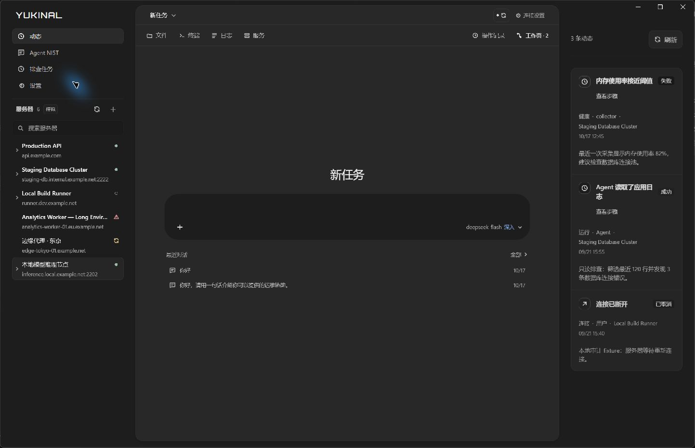

动态面板补充验收（2026-10-17）：实际 1443×931 原生窗口已核对日期分组、紧凑记录和整行展开；说明、执行者与工具步骤按需显示。浏览器已验证异常筛选、无工具步骤记录、无异常空态、键盘收起和长内容无横向溢出。临时对话仍沿用原来的大小与位置，现有工作页可恢复和收起。34 项相关测试、类型检查与生产构建通过。

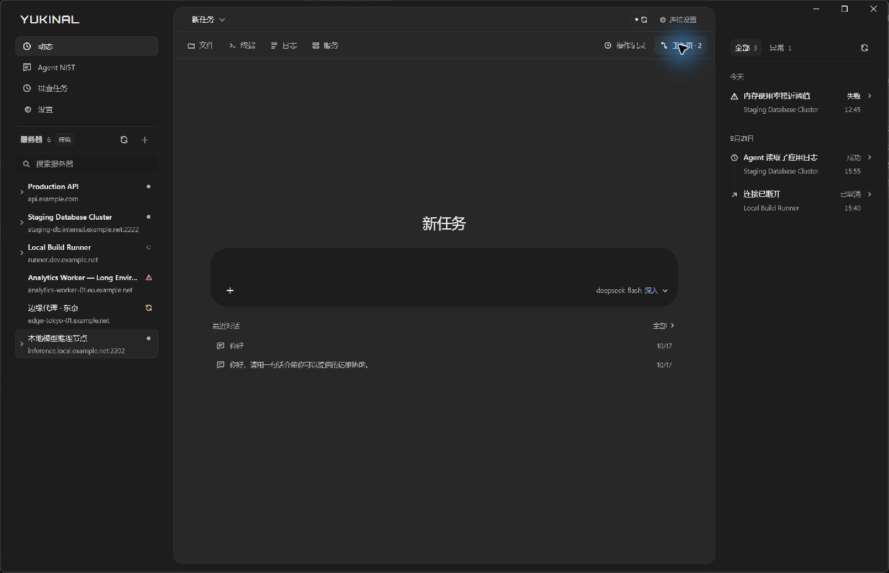

## 最近对话与网络检查（2026-10-17）

最近对话移入 AI 面板：空白任务在输入区下方显示当前范围最多三条记录，标题菜单保留全部记录、搜索与管理。左侧不再混入对话。打开记录期间暂停重复打开与发送；晚到结果按当前服务器再次核对。原生模拟窗口的真实测试对话属于独立预览数据目录中的全局范围，历史切换不会被模拟服务器 ID 误拒绝。已在实际窗口验证打开历史、返回新任务并恢复原草稿，未额外请求模型。

概览增加“网络与路由”。首层展开仅显示主机地址、默认网关与 DNS；完整网卡、IPv4 / IPv6 主路由表、优先级及累计字节在“完整配置”内展开。摘要展示原始配置与缺失状态，不把路由存在推断成网络可达。本机 DNS 代理不表示已读取上游 DNS。读取失败、无默认路由和旧服务未采集各自表达，离线快照标明缓存。

模拟数据新增配置完整、缺少默认路由和路由读取失败三种情况。实际 1443×931 原生窗口已核对：首层网络摘要与其余折叠项目可完整显示；浏览器紧凑布局未出现横向溢出。完整路由表展开后允许参考区自然滚动，不增加卡片内滚动条。

本轮桌面测试 323/323、共享契约 135/135、相关 Python 测试 52/52、类型检查和生产构建通过。服务器桌面 IPC 迁移与真实主机探测的限制见 [同类工具对比与实现边界](./ops-workbench-comparison-20261017.md)。

展开布局修订（2026-10-17）：动态详情使用侧栏完整内容宽度，说明与原因、执行者与时间、执行步骤之间分组留白。步骤只预览名称、状态和最多两行摘要；点击在已有中间工作页打开完整执行记录，环境、风险、批准来源、耗时、原始输入和结果均保留。超时、取消后的潜在效果与未知结果继续明确提示，结构化输出不再直接挤入侧栏。

服务器资源展开取消父层竖线和连续缩进，Docker 标题与容器列表平铺在原有侧栏范围内。容器首行显示名称和状态，展开后完整名称换行，镜像、运行状态与重启次数按字段分组，不重复名称。Docker 标题提供在中间查看服务的入口，工作页绑定对应服务器；展开仍遵循连接与主机身份核验条件，保留失败重试和空状态。

本轮验收：实际 1443×931 原生窗口核对两侧展开、长容器名称与镜像、完整执行记录工作页及恢复对话。原有终端会话、选定服务器与模型保留。浏览器测量左右栏均为 280px，动态详情 232px、服务器子列表 222px，长内容无横向溢出；已验证服务工作页绑定正确服务器，主导航与概览均无排查任务入口。59 项相关测试、类型检查与生产构建通过。

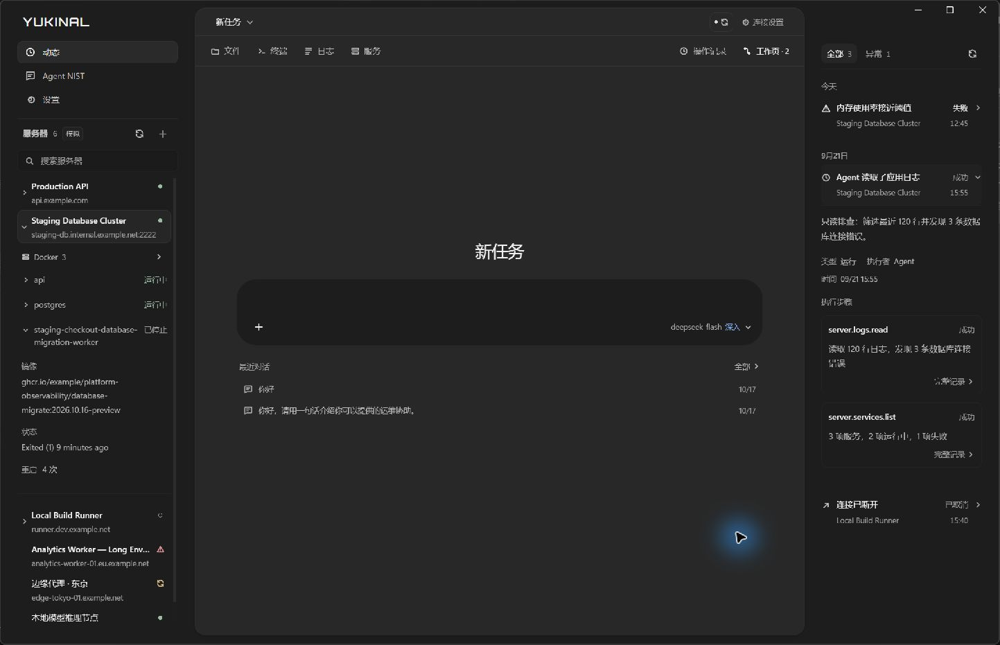

## 团队工作台与操作感知

团队、看板和值守沿用实际数据与入口。旧固定角色路由已在第五轮审计收尾清理，不把历史十三角色目录或模拟角色配置作为当前产品能力；真实子任务与阶段来自运行时事件。

现有 Agent 事件驱动对话阶段，以及服务器行、工具入口、主工具视图和面板上的队名与细描边呼吸。呼吸周期 1.8 秒，快速返回后保留约 1.8 秒渐隐余光。调用按 run/call 分开记录，一个结束不会清除另一个；操作目标以事件绑定的服务器为准。等待批准、失败、中断停止当前操作提示；减少动态效果时使用静态描边。模拟模式提供显式标注的双团队反馈预览，不连接服务器或记入用量。

发送对话时附加白名单内的栏目、选中服务器、可见工作页与最近入口语义，最近入口有效期 120 秒，同一次受理重试复用快照。界面参考不构成授权，不包含输入正文或鼠标轨迹，也不改变任务绑定的服务器。

值守读取现有持久计划并展示真实状态与结果。统一 30 秒时钟刷新 UI 和本窗口已上报用量，累计 usage 按 run ID 去重；未上报保持未知。值守是否运行以调度器与持久结果为准，不能仅因计划已启用就显示正在执行。完整职责、流式结构、工具整理、安全守卫、调度与用量规则见 [团队执行与持续值守设计](./team-operations-design-20261017.md)。

验收：338 项桌面测试、类型检查和生产构建通过。1280×720 浏览器测得左右栏各 280px，参考内容宽 232px；长值守目标展开无横向溢出。已验证配置编辑与取消、角色切换保留草稿、恢复自动匹配、对话直达值守；浏览器无控制台错误。1443×931 原生窗口核对团队与值守视图、长目标展开、队名提示与工具入口高亮。操作提示窗口验收使用显式模拟反馈，没有发送模型消息或远端命令；真实部署与后台自动值守仍按设计文档列出的接通条件验收。

### 看板与并行反馈增量验收

看板汇总最近最多 100 个持久任务与本窗口运行，固定四列：待处理、进行中、待确认、已结束。每列最小 188px，窄窗口只在看板内部横向滚动。搜索、服务器范围与团队筛选共用一行工具区。卡片只展示团队、状态、三行目标、服务器和时间；点击进入属性窗口查看完整信息。未保存团队关系的旧任务不猜测归属；一次模型回答结束不等于任务完成。关闭看板后，再次点击已选中的左侧入口也可恢复。

看板画布和状态列不加圆角外框，用留白与标题下的分隔线表达四列。任务卡保留 4px 小圆角和细边线，避免画布、列、卡片连续套框。浮动属性窗口保留单层外边界，内部字段与证据按分隔线组织。

AI 分析、调用工具时，对应任务卡和左侧看板入口使用描边呼吸。等待批准保持静态；持久任务已结束时，不被过时的运行事件重新点亮。快速调用保留短暂余光，按 run/call 独立清除。显式模拟预览只投影临时卡片，不写任务、会话或用量。

349 项桌面测试、5 项共享窗口契约测试、原生窗口上下文测试、类型检查和生产构建通过。1280×720 浏览器中左右栏仍各 280px，四列各 188px，看板内部宽 659px、内容宽 804px，页面无横向溢出。确认列与画布圆角为 0px、卡片为 4px；两次动效取样测得左侧入口描边透明度由 0.397 变为 0.644。已验证属性窗口放大还原、键盘移动与缩放、Escape 关闭后焦点返回原卡片，以及产物打开后关闭属性窗口；浏览器无控制台错误。1443×931 原生窗口核对四列、单层属性浮窗、鼠标拖动缩放、居中与双队描边演示。UI 动效使用明确标注的模拟反馈，没有发送模型消息或远端命令。

完整的会话隔离、宿主队列、同主机变更锁、流式事件与请求用量账本方案见 [多会话与并行 AI 执行](./parallel-sessions-design-20261017.md)。前端后台多会话执行尚未开放。

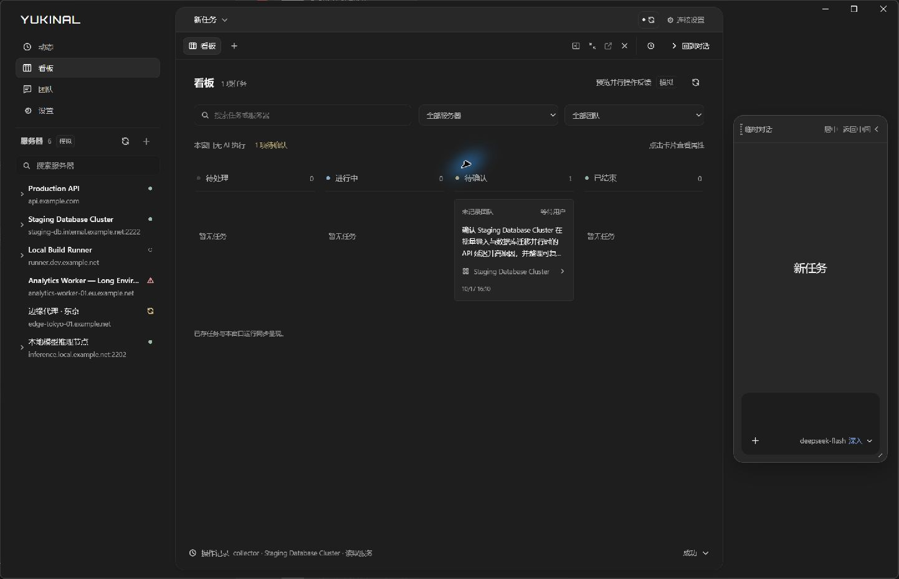

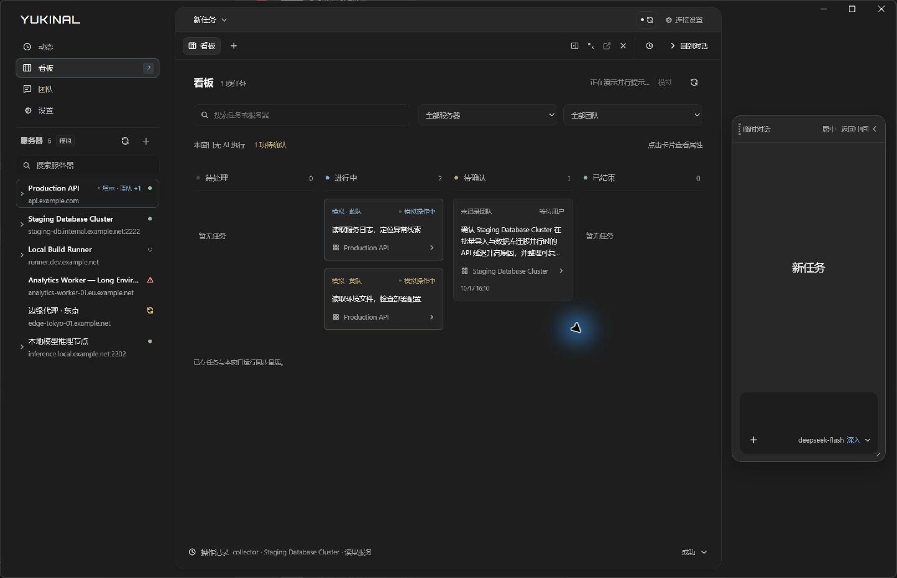

### 通用属性窗口

`SecondaryWindow` 统一属性信息的承载方式：无阻断遮罩，允许继续查看主工作区；标题栏可拖动，右下角可缩放，提供居中、放大还原、Escape 关闭与焦点返回。窗口在视口变化后保持标题与缩放入口可访问，内容独立滚动，底部信息固定。标签支持方向键导航；通用字段列表和分组复用同一排版。

任务属性分为概览、证据与产物、执行信息。完整目标、验收条件、错误、真实证据和产物按需显示；内部 ID 与预算放在执行信息中。服务器通过“更多 → 属性”复用同一窗口，显示连接、环境与检测能力；未知能力仍显示未检测，认证只说明引用是否配置。窗口绑定打开时的任务或服务器，不因用户选择其他目标而跳转。

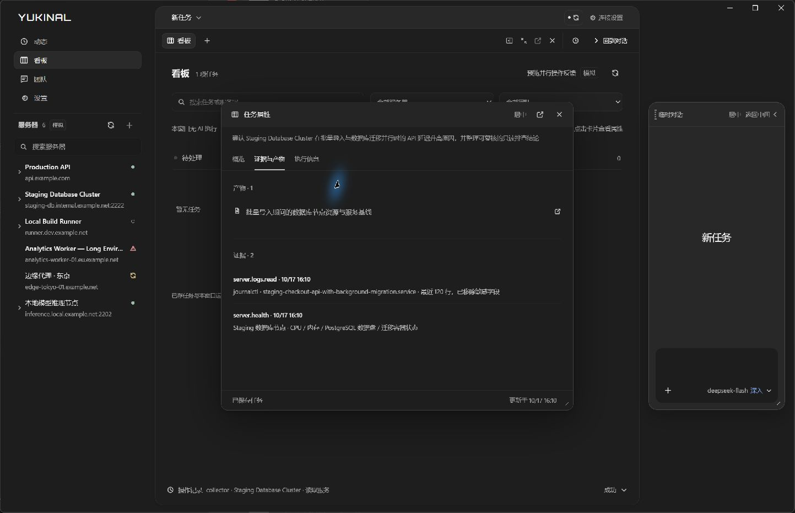

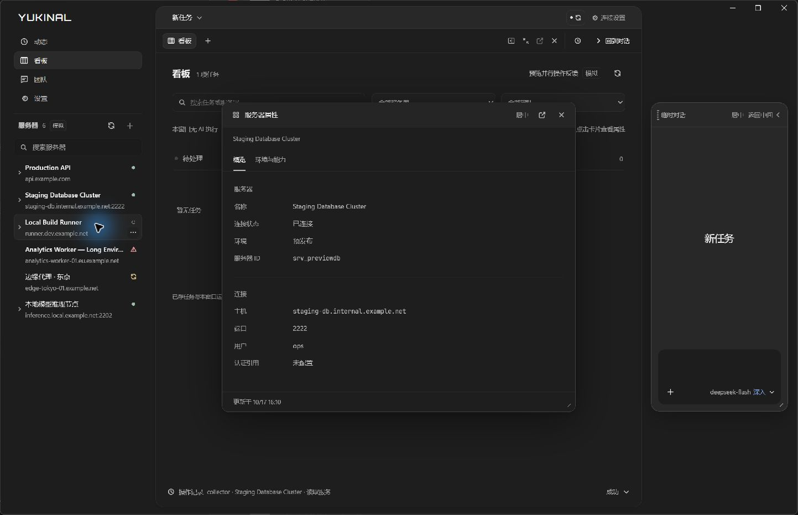

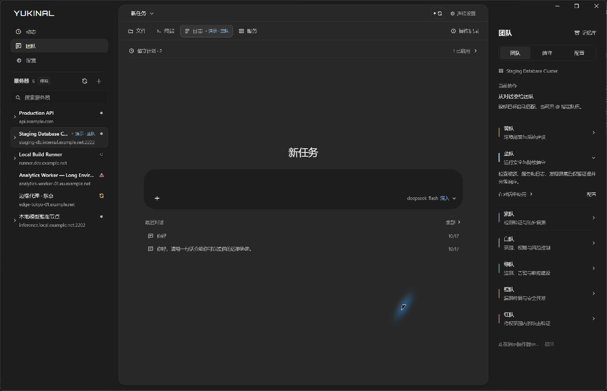

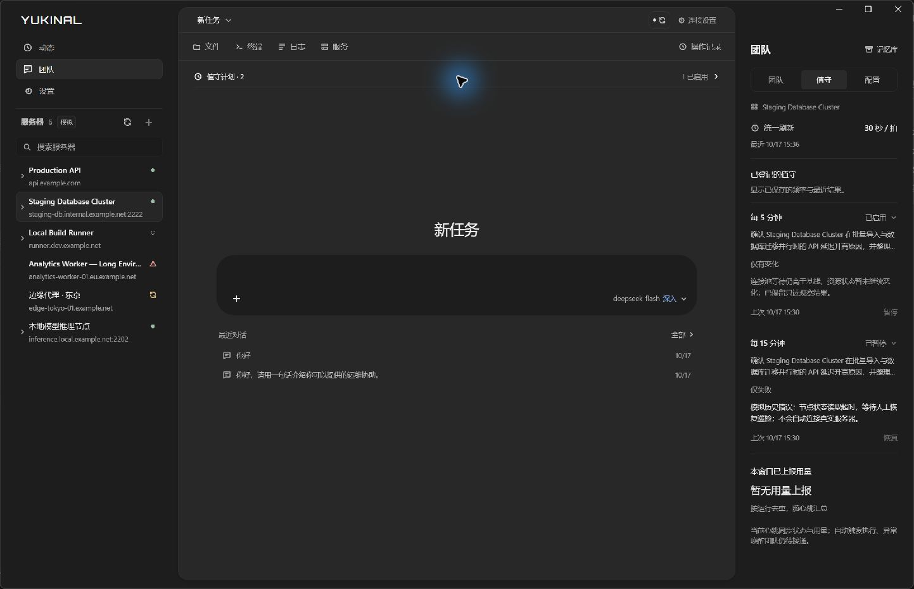

### 卡片阅读层级与品牌首字母

卡片继续固定在四列中，默认宽高比为 16:9；标题移到第一行，使用 14px 正文字号、600 字重和高对比文字，最多展示三行。团队与状态位于标题下方，服务器与相对更新时间合并在底行，完整时间保留在提示中。悬停可看完整标题，点击仍在通用属性窗口查看原始目标；没有改写持久任务内容。字号增大时允许内容所需的最小高度优先，避免强制比例裁掉状态。

沿用卡片 4px 小圆角细边线；画布和四列无外框，没有新增套框。左上角品牌仅首字母 Y 使用材质变量 `--brand-initial: #91cba4`，其余字母保持原有颜色与尺寸。

1280×720 浏览器实测四列各 188px，三张代表卡片均为 188×105.75px，比例准确为 16:9；标题 14px / 600，按钮内容无纵向裁切，页面无横向溢出，两侧仍各 280px。验证了长标题属性查看、Escape 焦点返回和双队操作描边，控制台无错误。1443×931 原生窗口核对标题、三张卡片与绿色 Y。17 项相关测试、类型检查和生产构建通过。

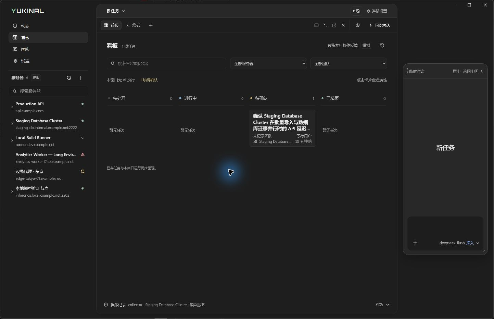

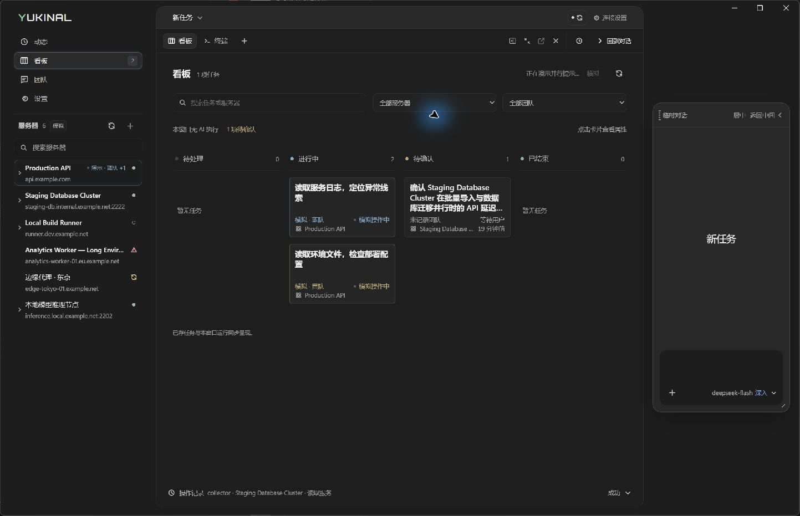

统一对话入口如何分派团队、接收后台结果，以及与现有会话、权限、心跳和 token 账本的接入顺序，见[协调助手研究](./dots-coordinator-research-20261017.md)。此处为研究方案，未启用后台自动执行。
