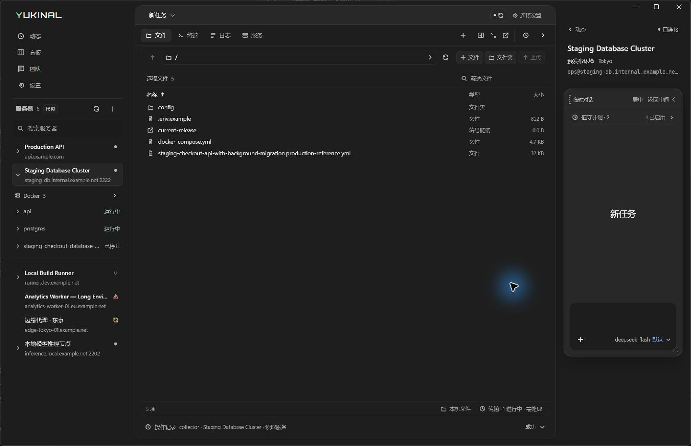
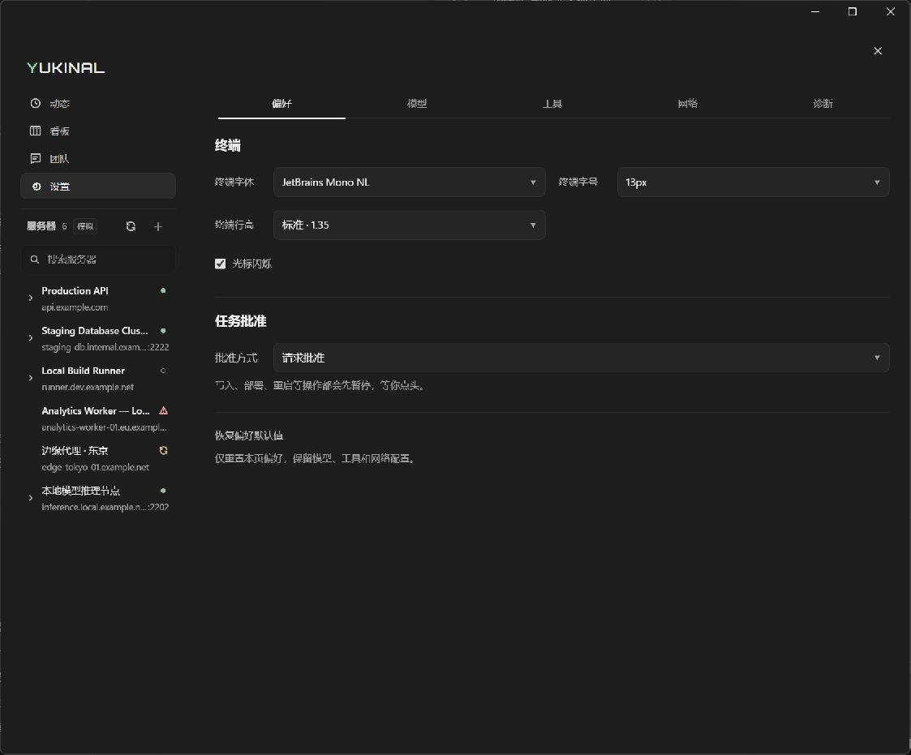

# 缩放、固定工作页与右侧面板复查

本轮接续 [HIG 界面巡检](./ui-hig-audit-2026-10-17.md)，处理窗口放大后的顶部边界、还原比例、工具入口跳位和侧栏展开密度。

## 修复行为

- 最大化客户区按当前显示器工作区裁剪，排除系统不可见缩放边缘。原生窗口只通过一条路径调整 WebView 尺寸，避免一次缩放产生两个不同视口。
- 还原窗口的最上沿优先命中缩放热区，左右角可直接缩放；标题栏按钮在边缘下方保持原生行为，避免拖动右上角时误触关闭。
- 跨越 1180px 布局断点时保留参考面板的展开选择，放大后恢复三栏，缩回后继续原来的页面状态。
- 文件、终端、日志和服务使用常驻固定标签，固定页不能关闭。新增工作页使用“＋”，可单独关闭；新终端使用独立会话。工具栏高度、标签宽度和操作预留区保持稳定。
- 右侧沿用原有栏宽，增加详情分组和表单间距；长地址单行省略并保留完整提示，服务器页签按实际四项排列。动态执行步骤、团队配置和值守详情使用平铺内容与留白；日志统一由外层滚动。

固定页切换到另一服务器时，旧页保持原来的目标和终端会话，作为普通页继续存在。工作页队列仍限制为八页，固定页不会被新增页挤掉；超出上限的普通页进入最近关闭记录。

## 验证

- Windows 原生窗口实际完成缩小、放大、最大化和还原，核对尺寸、位置、顶部衔接和设置展开状态。
- 浏览器 1280×720 实测四个固定标签打开前后的坐标完全一致；新增终端出现独立标签，关闭后四个固定标签保留。
- 检查动态展开、团队展开、值守详情、角色编辑、设置五个分区及高级模型选项、诊断日志、服务器概览／属性／日志／服务／活动详情和连接引导。测量的可见控件没有横向越界或相互重叠，右栏宽度保持 280px。
- `pnpm check` 通过：桌面测试 371 项通过，原生 CTest 8 项通过，类型检查、发布构建、契约检查和 Python 侧车 smoke 通过。control-plane 测试因未安装其独立环境而跳过。
- 原生几何回归包括负坐标显示器、高 DPI 边框、顶部任务栏的工作区计算和角部缩放热区；固定页回归覆盖不可关闭、容量保护、旧目标保留和新增终端会话隔离。

## 验证边界

浏览器使用模拟数据，未执行真实 SSH、部署、文件写入或模型请求。不同 DPI、多显示器切换和独立工作页窗口的完整交互组合仍需专项验收；几何单元测试不能替代这些运行验证。
